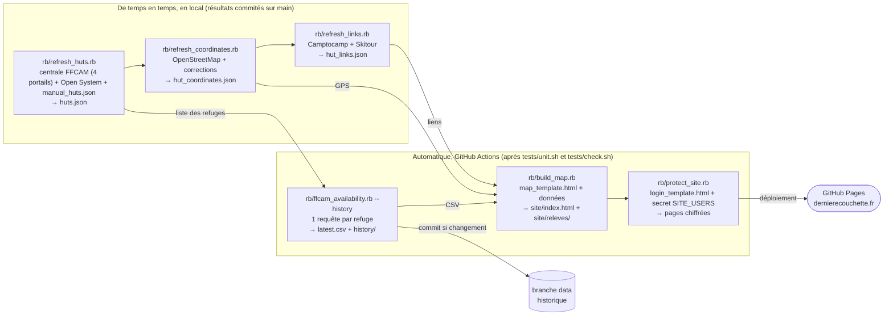

# Dernière couchette — handover

_État au 22/11/2026._

Dernière couchette est une carte des places libres dans les refuges de montagne pour le week-end en cours, en ligne sur [dernierecouchette.fr](https://dernierecouchette.fr/) et mise à jour automatiquement par GitHub Actions.

- **Couverture** : 154 refuges, venant de 5 systèmes de réservation (centrale FFCAM, Open System, Refuge Pro, WP Booking System) ou ajoutés à la main ; détail par refuge en [annexe](#annexe--source-de-chaque-refuge).
- **Code** : Ruby, bibliothèque standard seulement (aucune gem), scripts dans `rb/` + une page HTML Leaflet. Version : `.ruby-version` (4.0.9, utilisée par GitHub Actions) ; le code tourne aussi sur Ruby 3.1 à 3.3 (vérifié avec les tests).
- **Fréquence** (heure de Paris, lancé par cron-job.org) : de décembre à avril, toutes les heures à la minute 7 sauf de 1 h à 5 h ; en mai, octobre et novembre, une fois par jour à 7h07 ; aucun relevé de juin à septembre.
- **Historique** : chaque changement de places est conservé sur la branche `data`, pour de futures analyses (pas encore affiché).

## Sommaire

- [Architecture](#architecture)
- [Sources de données](#sources-de-données)
- [Récupérer les disponibilités : les requêtes](#récupérer-les-disponibilités--les-requêtes)
- [La carte](#la-carte)
- [Historique des disponibilités](#historique-des-disponibilités)
- [Mise en ligne](#mise-en-ligne)
- [Accès (prénom + mot de passe)](#accès-prénom--mot-de-passe)
- [Opérations courantes](#opérations-courantes)
- [Tests](#tests)
- [En suspens](#en-suspens)
- [Pièges connus et décisions](#pièges-connus-et-décisions)
- [Annexe : source de chaque refuge](#annexe--source-de-chaque-refuge)

## Architecture

Deux rythmes : trois scripts « de référence » lancés à la main de temps en temps, et deux scripts lancés automatiquement à chaque relevé.



Les scripts sont dans `rb/` et s'y lancent directement (`rb/<script>.rb`, ligne `#!/usr/bin/env ruby`) ; ils lisent et écrivent leurs fichiers de données (`huts.json`, `history/`, `map.html`…) dans le dossier parent de `rb/`, la racine du dépôt, quel que soit le dossier courant ; seul le CSV par défaut de `rb/ffcam_availability.rb` (`ffcam_<date>.csv`) va dans le dossier courant : les lancer depuis la racine. Modules partagés : `rb/ffcam.rb` (requêtes, portails, Open System, Refuge Pro, WP Booking System), `rb/history.rb` (historique), `rb/fetch_log.rb` (journal des relevés), `rb/py.rb` (formats d'écriture des fichiers, voir [décisions](#pièges-connus-et-décisions)), `rb/difflib.rb` (similarité des noms).

| Fichier | Contenu | Produit par | Versionné |
| --- | --- | --- | --- |
| `huts.json` | 154 refuges : id, nom, type, portail, site | `rb/refresh_huts.rb` | oui (main) |
| `hut_coordinates.json` | GPS, altitude, id OSM, site OSM | `rb/refresh_coordinates.rb` | oui (main) |
| `coordinates_overrides.json` | 6 corrections GPS faites à la main | à la main | oui (main) |
| `manual_huts.json` | refuges ajoutés à la main : position, site, téléphone, email, et `refugepro` (slug du calendrier) ou `wpbs` (pages du calendrier WordPress) s'ils en ont un | à la main | oui (main) |
| `hut_links.json` | liens Camptocamp et Skitour | `rb/refresh_links.rb` | oui (main) |
| `map_template.html` | la carte (HTML, CSS, JS Leaflet) | à la main | oui (main) |
| `history/` | historique des places + `fetch_log.json` (journal des relevés) | `rb/ffcam_availability.rb --history` | oui (branche `data`) |
| `log_template.html` | page de suivi des relevés | à la main | oui (main) |
| `login_template.html` | écran de connexion qui enveloppe chaque page publiée (voir [Accès](#accès-prénom--mot-de-passe)) | à la main | oui (main) |
| `secrets.env` | clé Skitour (et IGN éventuelle) | à la main | **jamais** |
| `.ruby-version` | version de Ruby (GitHub Actions, mise / rbenv en local) | à la main | oui (main) |
| `tests/` | tests unitaires et rejeu hors ligne (voir [Tests](#tests)) | à la main | oui (main) |
| `ffcam_*.csv`, `map.html`, `releves/`, `data/`, `site/` | sorties générées | scripts | non (`.gitignore`) |
| `deploy/` | plan B VPS OVH + nginx + certbot | — | oui, jamais utilisé |

## Sources de données

Les places viennent de quatre systèmes de réservation, lus là où les refuges les publient eux-mêmes, sans clé ; le reste (GPS, liens, fonds de carte) vient de services ouverts.

| Source | Ce qu'on en tire | Accès | Particularités |
| --- | --- | --- | --- |
| [Centrale FFCAM](https://centrale.ffcam.fr/index.php) | liste des refuges + places par nuit | sans clé | voir [les requêtes](#1-centrale-ffcam-portails-ffcam-vanoise-neouvielle-boreon) |
| Portails de la centrale (`apporigin`) | refuges hors liste FFCAM | sans clé | FFCAM (115), VANOISE (+9), NEOUVIELLE (+3), BOREON (+1). Disponibles non utilisés : ENTREPYRPYRENEES (52, Espagne/Andorre), ITFFCAM (tout + Maroc). |
| Open System (Alliance Réseaux) | 12 refuges du Parc de la Vanoise (Leisse, Fond des Fours…) | sans clé | voir [les requêtes](#2-open-system-12-refuges-du-parc-de-la-vanoise-portal--opensystem). **Pas de capacité.** |
| [Refuge Pro](https://refuge-pro.com) | 11 refuges privés (Clarée, Vallée Étroite, Galibier, Maurienne…) : places, capacité, liste d'attente | sans clé | Calendrier « embed » que chaque refuge intègre à son site ; voir [les requêtes](#3-refuge-pro-11-refuges-portal--refugepro). ~1 an de nuits. |
| WP Booking System | Refuge de la Coire : places par nuit | sans clé | Extension WordPress dont le calendrier est dans la page du site du refuge ; voir [les requêtes](#4-wp-booking-system-refuge-de-la-coire-portal--wpbs). Deux mois (le mois en cours et le suivant). **Pas de capacité.** |
| OpenStreetMap (Overpass) | GPS, altitude, site web | sans clé | Souvent surchargé : le script essaie 3 serveurs et réessaie (jusqu'à plusieurs minutes). Appariement par site `*.ffcam.fr`, puis par nom, puis corrections manuelles. |
| Nominatim (OSM) | recherche ponctuelle d'un refuge introuvable | sans clé | Utilisé à la main pour remplir `coordinates_overrides.json`. |
| [Camptocamp](https://www.camptocamp.org) | lien fiche refuge | API publique | Recherche dans un rayon de 1,5 km, acceptée si < 400 m ou nom proche. 150/154 trouvés. |
| [Skitour](https://skitour.fr/api/) | lien fiche refuge | clé perso (gratuite, 1000 req/j) | `GET /api/refuges` avec en-tête `cle`. 125/154 trouvés. Les conditions demandent un lien vers skitour.fr. |
| IGN Géoplateforme | fonds Plan IGN, traces ski de rando | sans clé | Couche `TRACES.RANDO.HIVERNALE` (rouge, recolorée en bleu en CSS). SCAN 25 = clé privée : code prêt, jamais testé. |
| Esri, OpenTopoMap, OSM France | fonds de carte | sans clé | `tile.openstreetmap.org` refuse les pages sans `Referer` (fichier local) : on utilise OSM France. CARTO exige désormais une clé : abandonné. |

## Récupérer les disponibilités : les requêtes

Quatre systèmes, un appel par refuge et par relevé (par page pour WP Booking System), choisi selon le champ `portal` du refuge dans `huts.json` (code : `Ffcam.fetch_availability` dans `rb/ffcam.rb`). Aucun ne demande de clé ni de cookie. Les requêtes passent toutes par `Ffcam.polite` : 2 simultanées au plus et 0,3 s entre deux départs par site.

### 1. Centrale FFCAM (portails FFCAM, VANOISE, NEOUVIELLE, BOREON)

**Liste des refuges d'un portail** — GET, une fois par portail :

```
GET https://centrale.ffcam.fr/index.php?mode=FORM&_lang=FR&init=1&apporigin=FFCAM
```

La page HTML contient une ligne `structuresList = {"BK_STRUCTURE:85": {...}, ...};` (extraite par regex puis JSON) : `name`, `shortName`, `structureType`, `email` obfusqué, `maxPax`, `maxDays`, `bookingDelay`, `productsCategories`. Remplacer `apporigin` pour un autre portail ; un refuge présent dans plusieurs portails est gardé avec le premier de la liste.

**Places d'un refuge** — POST, formulaire :

```
POST https://centrale.ffcam.fr/index.php?
action=availability
apporigin=FFCAM            # un portail qui liste ce refuge
structure=BK_STRUCTURE:22
productCategory=nomatter   # tous types d'hébergement confondus
pax=1
date=2026-11-21            # aujourd'hui par défaut
```

La réponse est la page HTML du calendrier ; on en extrait trois objets JS (une ligne chacun) :

```
BK.availability      = {"2026-11-21": 24, ...}         # places libres
BK.totalAvailability = {"2026-11-21": 24, ...}         # capacité de la nuit
BK.openingCalendar   = {"2026-11-21": "OPEN", ...}     # OPEN | CLOSE | UNGUARDED | UNKNOW
```

- Couverture : le mois de `date` et le mois suivant, en entier. Pour un refuge pas encore réservable, le serveur décale souvent ces deux mois vers ses premières dates réservables.
- Demander avec un `apporigin` qui ne liste pas le refuge renvoie des données vides ou incohérentes : d'où le champ `portal`.
- Réservable = `opening == OPEN` et places > 0.

### 2. Open System (12 refuges du Parc de la Vanoise, `portal = OPENSYSTEM`)

**Découverte des refuges** (dans `rb/refresh_huts.rb`, via `Ffcam.fetch_opensystem_huts`) : la page d'accueil de [refuge-leisse.vanoise.com](https://refuge-leisse.vanoise.com/) liste les autres refuges du Parc (`https://refuge-xxx.vanoise.com`). Sur chaque site, le widget de réservation porte l'id produit :

```
AllianceReseaux.Widget.Instance("Produit", { idPanier: "AGwCAAA", idIntegration: "1110", ui: "OPRF-92948" })
```

Pas d'`OPRF` sur la page = refuge qui réserve via la centrale FFCAM (Arpont, Orgère, Valette) : ignoré ici. L'id stocké dans `huts.json` est `OPRF-92948`.

**Places d'un refuge** — GET, réponse JSONP (le paramètre `callback` est facultatif) :

```
GET https://etape-rest.for-system.com/index.aspx/index.aspx?ref=json-planning-refuge&q=92948,2027-03-07

([{"id":92948,"datemini":"2026-11-24",
   "planning":[{"s":0,"f":1,"d":15}, ..., {"s":25,"f":0,"d":0}, ..., {"s":32,"f":0,"d":-14}]}])
```

- `planning` = 30 jours, **de q−15 à q+14** (q = la date demandée), du plus ancien au plus récent.
- Le jour d'une entrée = **q − d** (`d` = jours *avant* q : 15 pour le premier, 0 pour q, −14 pour le dernier).
- `s` = places libres ; `f` = 1 si fermé ; `datemini` = première date réservable. **Aucune capacité** : la carte affiche « N places » sans total.
- Le script demande q = aujourd'hui + 15, pour couvrir d'aujourd'hui à J+29 (les deux week-ends affichés y sont toujours).
- Vérifié sur la Leisse : fermé le 19/02/2027, ouvert le 20/02 avec 25 places, comme annoncé sur son site.

### Format commun en sortie

Les méthodes de chaque système renvoient le même hash, ce qui permet au reste (CSV, historique, carte) de ne pas distinguer les systèmes :

```
{"free": {"2026-11-21": 24, ...}, "capacity": {"2026-11-21": 24 ou None, ...}, "opening": {"2026-11-21": "OPEN", ...}}
```

Pour ajouter un nouveau système : une méthode de `Ffcam` qui renvoie ce hash, un `portal` dédié dans `huts.json`, et une branche dans `Ffcam.fetch_availability`.

### Mode de réservation d'une nuit (`booking`)

La centrale FFCAM dit aussi, nuit par nuit, **comment** réserver, via les classes CSS des cases du calendrier renvoyé (`<div class="day …"><a data-date="2026-12-12" …>`, lu par `Ffcam.booking_modes`) :

| Classe de la case | `booking` | Signification |
| --- | --- | --- |
| `day dispo` | `online` | réservable en ligne |
| `day complet waitinglistday` | `waitlist` | complet, inscription en liste d'attente possible |
| `day completWeb completWebInfo` | `phone` | plus vendu en ligne (souvent ce soir, après le délai de réservation) : « Réserver par téléphone / mail » |

Refuge Pro fournit l'équivalent, WP Booking System en partie (voir plus bas). Les refuges `MANUAL` ne sont pas interrogés : toutes leurs nuits valent `request`. Open System ne fournit pas cette information.

| Source | `online` | `waitlist` | `phone` | `request` |
| --- | --- | --- | --- | --- |
| Centrale FFCAM | `day dispo` | `waitinglistday` | `completWeb` | — |
| Refuge Pro | places > 0 | complet + `waitlistEnabled` | délai dépassé, saison pas encore ouverte | — |
| WP Booking System | réservable, « N pl. » affiché | — | — | réservable sans nombre de places affiché |
| Open System | — (rien) | — | — | — |
| `MANUAL` | — | — | — | toutes les nuits |

### 3. Refuge Pro (11 refuges, `portal = REFUGEPRO`)

Refuge Pro est le logiciel de réservation que ces refuges utilisent ; il fournit un calendrier à intégrer dans le site du refuge. On lit cette page « embed » (pas la vitrine tierce refuge.camp, ni son API) :

```
GET https://refuge-pro.com/embed/calendrier/refuge-de-terre-rouge
```

C'est une page Next.js : ses données sont dans des blocs `self.__next_f.push([1,"…"])`. Une fois concaténés et décodés, on y trouve un objet JSON `"availability": {…}` (lu avec `Py.raw_decode`, qui lit un objet JSON à partir d'une position et ignore la suite) :

```
{"defaultCapacity":35, "bookingCutoffDays":1, "waitlistEnabled":true,
 "nextSeasonOpening":{"premiereNuit":"2027-06-12","ouvreLe":"2027-01-15"},
 "openingRanges":[{"from":"2027-01-09","to":"2027-04-10"}, …],
 "data":[{"date":"2027-01-23","capacity":35,"booked":35,"free":0,"status":"open","isFull":true}, …]}
```

- `data` couvre **environ un an** (346 nuits), avec capacité, réservé et libre par nuit.
- `booking` : complet + `waitlistEnabled` → `waitlist` ; nuit avant aujourd'hui + `bookingCutoffDays`, ou au-delà de `premiereNuit` tant que `ouvreLe` n'est pas passé → `phone` (places mises à 0) ; sinon `online`.
- Le slug est l'adresse du calendrier ; il est noté dans `manual_huts.json` (champ `refugepro`). Il n'y a pas de liste publique des refuges Refuge Pro : les 11 slugs ont été trouvés en essayant le nom du refuge (`chardonnet`, `refuge-du-clot-des-vaches`…) ; une page inexistante répond 404.
- La page donne aussi le téléphone du refuge (`telephoneRefuge`) mais **pas sa position** : position et altitude viennent d'OpenStreetMap (Nominatim), notées dans `manual_huts.json`.
- Lien principal sur la carte = ce calendrier (bouton « Réserver ») ; le site propre du refuge, quand il existe, est dans le champ `website`.
- **Pas de vitrine tierce** : ces refuges sont aussi vendus sur refuge.camp (même éditeur), qu'on n'utilise pas ; on lit le calendrier du refuge.

### 4. WP Booking System (Refuge de la Coire, `portal = WPBS`)

[WP Booking System](https://www.wpbookingsystem.com/) (extension WordPress « wp-booking-system-premium ») affiche un calendrier dans une page du site du refuge. Le calendrier est rendu côté serveur, dans le HTML de la page :

```
GET https://www.refugedelacoire.fr/reservations-hiver/

<div class="wpbs-container ... wpbs-calendar-12 " data-id="12" data-months_to_show="2"
     data-current_year="2026" data-current_month="11" data-changeover_start="58" data-changeover_end="59" ...>
  <div class="wpbs-date wpbs-legend-item-66 wpbs-is-bookable " data-year="2026" data-month="11" data-day="28" ...>
     ... <span class="wpbs-inventory">1 pl.</span> ...
  ...
  <div class="wpbs-legend"><div class="wpbs-legend-item"><div class="wpbs-legend-item-icon wpbs-legend-item-icon-66" ...>
     <span class=wpbs-legend-item-name>Disponible (non-gardé)</span></div> ...
```

- Une case par jour : `wpbs-legend-item-<n>` = l'état du jour, `wpbs-is-bookable` = sélectionnable, `wpbs-inventory` = places restantes (« N pl. », ou `wpbs-full` « Complet » ; souvent absent sur les jours passés).
- Les noms des états sont lus dans la légende du calendrier (les numéros changent d'un site et d'un calendrier à l'autre) et classés par sens (`Ffcam.wpbs_meaning`) : « Disponible… » = disponible, « Complet » = complet, « Non-disponible », « Voir refuge été », « Fermé » = fermé. Coire, calendrier 12 : 56 « Disponible (selon conditions) », 66 « Disponible (non-gardé) », 57 « Complet », 60 « Voir refuge été », 67 « Non-disponible » ; 58 et 59 (`data-changeover_start` / `_end`, absents de la légende) = début et fin d'une réservation sur plusieurs jours : la nuit du début est prise, celle de la fin est libre.
- Règles (`Ffcam.parse_wpbs`), dans l'ordre, jours passés ignorés : inventaire « Complet » ou « 0 pl. » → `OPEN`, 0 place (complet) ; état fermé → `CLOSE` ; réservable avec « N pl. » → `OPEN`, N places, `online` ; état complet (dont début de réservation) → `OPEN`, 0 ; non réservable → `CLOSE` ; **réservable sans nombre de places affiché → `OPEN`, places inconnues (vide), `request`** (affiché « Sur demande » : on sait que la nuit est ouverte, pas combien il reste de places). La différence « Disponible (selon conditions) » / « non-gardé » n'est pas reprise sur la carte.
- Pas de capacité (comme Open System) : la carte affiche « N places » sans total.
- Couverture : les mois présents dans la page seulement (Coire : le mois en cours et le suivant, assez pour les deux week-ends affichés). Les autres mois sont chargés par le site via `admin-ajax.php` : non utilisé.
- Page sans calendrier `wpbs-container`, ou calendrier sans aucune case datée → erreur (`err` sur `/releves/`, « RuntimeError: no WP Booking System calendar on <url> » / « no day in the WP Booking System calendar of <url> »).
- Configuration dans `manual_huts.json`, champ `wpbs` : une liste de pages `[{"url": "…", "calendars": [14]}]` (`calendars` facultatif : sinon tous les calendriers de la page) ; un jour présent dans plusieurs calendriers ou pages est pris dans le premier. Une requête par page.
- **Été pas encore lu** : la page [réservations été](https://www.refugedelacoire.fr/reservations-ete/) a deux calendriers (14 et 15, à partir de juin 2027, autres numéros d'états : 70, 74, 76, 80). Il suffira d'ajouter la page à `wpbs` quand on saura comment combiner ses deux calendriers (aujourd'hui : le premier l'emporte, sans addition des places).
- Lien principal sur la carte = la page de réservation (bouton « Réserver »).

### 5. Refuges sans réservation en ligne lisible (`portal = MANUAL`)

Nant du Beurre, Selle : ajoutés à la main dans `manual_huts.json`, avec position (refuges.info), site, téléphone et email pris sur leur propre site. Pas de requête : toutes leurs nuits valent `request`.

## La carte

Une seule page HTML (`map_template.html` + les données injectées par `rb/build_map.rb`), Leaflet 1.9.4, sans serveur, design « Crêtes » : billets de couchette en papier crème, vert sapin, thème clair uniquement.

**Panneau de gauche** (feuille glissante en bas sur téléphone)

- En-tête : logo (lits superposés + étoile), titre, date de mise à jour, ligne de crêtes.
- Carrousel de nuits en billets : nuit choisie centrée, voisines à moitié visibles, samedi par défaut ; clic, flèches ← →, glissement au doigt.
- Chiffres clés (réservables, places, complets) : **limités au cadre de la carte**.
- Filtres : minimum de places, « Afficher les fermés » (complets + fermés), types Gardé / Non gardé / Autre (avec icônes ; clic sur un type quand tous sont actifs = ne garder que lui), recherche sans accents (un nom trouve le refuge même fermé ou hors du cadre).
- Liste des refuges **dans le cadre de la carte**, en petits billets ; clic = la carte vole au refuge.

**Carte**

- Marqueurs en talons de billet (places + pastille vert / orange / rouge), fermés = point gris.
- Fiche refuge : type, altitude, max par résa, une ligne par nuit, boutons Fiche FFCAM / Site du refuge / Réserver, Camptocamp, Skitour.
- Fonds : Topo clair Esri (défaut), OpenTopoMap, satellite Esri, Plan IGN, OSM France ; calque « Traces ski de rando (IGN) » ; SCAN 25 si clé IGN.
- Vue de départ : Alpes, du Léman aux Hautes-Alpes.

**Nuits affichées** : lundi–vendredi = vendredi, samedi, dimanche à venir ; samedi = ce soir + dimanche ; dès le dimanche = vendredi, samedi, dimanche du week-end suivant.

**Mode caché « Avant-dernière couchette »** : clic sur le logo (ou `#avant-derniere` dans l'URL) = week-end suivant, en-tête teinté crépuscule, étoile retournée. Les données sont déjà dans la page (5 nuits par refuge le samedi).

**Téléphone** : tout le panneau défile d'un bloc avec un bandeau collant (titre + billets compacts), filtres repliés derrière « Filtres · n actifs », panneau jusqu'à 90 % de l'écran. Testé en simulation seulement, pas au doigt.

**Refuges sans capacité connue** (Open System, WP Booking System) : affichés « 25 places » au lieu de « 25 / 32 ».

**Catégorie « Sur demande »** (violet, affichée par défaut avec les réservables) : nuits FFCAM en liste d'attente (marqueur `…`) ou à réserver par téléphone / mail (`☎`), refuges `MANUAL` de `manual_huts.json` (`☎`), et nuits WP Booking System réservables sans nombre de places affiché. La fiche donne le téléphone et l'email quand on les connaît. Les chiffres clés comptent « réservables / places / sur demande » ; les vrais complets et les fermés restent derrière « Afficher les fermés ».

## Suivi des relevés (`/releves/`)

Une page publique, [dernierecouchette.fr/releves/](https://dernierecouchette.fr/releves/) (lien sur la date de mise à jour de la carte), dit si la récupération des places s'est bien passée pour chaque refuge au dernier relevé.

- **Production** : à chaque relevé, `rb/ffcam_availability.rb --history` appelle `FetchLog.record` (module `rb/fetch_log.rb`), qui classe chaque refuge et met à jour `history/fetch_log.json` sur la branche `data`. `rb/build_map.rb` génère ensuite la page à partir de `log_template.html`, dans `releves/index.html` à côté de la carte (`site/releves/` en ligne).
- **États** : `ok` (nuits reçues ; une remarque si aucun calendrier d'ouverture n'est publié, normal pour un refuge fermé), `warn` « à vérifier » (réponse sans aucune nuit : souvent un changement de format), `err` (requête en échec : délai, erreur HTTP, page sans données ; le message de l'exception est gardé), `skip` « non relevé » (refuges `MANUAL`).
- **`fetch_log.json`** : `last_run` (le dernier relevé, une entrée par refuge : état, nuits reçues, durée, message), `runs` (les 48 derniers relevés résumés par source, avec la liste des refuges en problème), `last_success` (dernier relevé réussi par refuge). Le déclencheur vient du champ `source` de `workflow_dispatch` (« cron-job.org »), sinon de `GITHUB_EVENT_NAME` (push, manuel) ou vaut « local ».
- **Page** : le dernier relevé (durée, nombre de requêtes, déclencheur, résumé), un billet par source (refuges sans erreur / total, 24 derniers relevés en barres, durée cumulée, dernier succès), puis le tableau des refuges filtrable (À traiter, Erreurs, Remarques, Non relevés, Tous) avec recherche.
- **Effet de bord** : ce fichier change à chaque relevé, donc la branche `data` reçoit un commit par relevé (et non plus seulement en cas de changement de places).
- Sans `--history` (tout lancement à la main), le journal n'est pas écrit non plus ; `--log <fichier>` permet de l'écrire ailleurs pour tester.

## Historique des disponibilités

Chaque relevé ajoute une ligne par changement de places, pour toutes les nuits à venir renvoyées (pas seulement le week-end) ; rien n'est encore affiché sur la carte.

- **Où** : branche `data` du dépôt ; en local, le dossier `history/` est un worktree git de cette branche.
- **Qui écrit** : seulement `rb/ffcam_availability.rb --history`, que passent le workflow et `deploy/run_update.sh`. Sans cette option (défaut), le script n'écrit ni l'historique ni le journal des relevés : un lancement à la main ne touche jamais `history/`. (`--no-history` est encore accepté et ne fait rien.) Le dossier est toujours `history/` à côté de `rb/` : une copie du projet a son propre `history/`.
- **Fichiers** : `availability_AAAA-MM.csv` (un par mois de relevé) et `state.json` (dernier état connu par refuge/nuit, une ligne par clé pour des diffs git légers ; les nuits passées en sont retirées).
- **Colonnes** : `fetched_at, hut_id, date, opening, free_beds, capacity` (heure de Paris).
- **Lire** : l'état d'une nuit à un instant = la dernière ligne avant cet instant pour ce `hut_id` et cette `date`.
- **Volume** : état initial 5 084 lignes (308 Ko) le 21/11/2026 ; ensuite quelques dizaines à centaines de lignes par jour attendues en saison (à confirmer).

**Limites**

- Fenêtre suivie : d'aujourd'hui à la fin du mois suivant (FFCAM, WP Booking System) ou 30 jours (Open System). Les réservations plus lointaines ne sont vues qu'en entrant dans la fenêtre ; une 2e requête par refuge l'élargirait mais a été écartée (charge x2).
- FFCAM décale parfois la fenêtre vers les premières dates réservables d'un refuge : des nuits lointaines (jusqu'en juillet) apparaissent pour certains.
- Une requête en erreur n'enregistre rien (pas de faux « 0 place »).
- Lancer `rb/ffcam_availability.rb --history` en local sans `git pull` dans `history/` fait diverger l'historique : ne le faire que volontairement, après `git pull`.

## Mise en ligne

Le site est publié par GitHub Actions sur GitHub Pages, derrière le domaine dernierecouchette.fr acheté chez OVH, en HTTPS.

| Élément | Réglage |
| --- | --- |
| Dépôt | `jor-di/ffcam-huts`, public, branche par défaut `main` (obligatoire pour la publication Pages et `workflow_dispatch`) |
| Déclenchement | cron-job.org appelle `workflow_dispatch` (voir ci-dessous) ; pas de planning GitHub |
| Tâche | `.github/workflows/update.yml` : lancé par cron-job.org (`workflow_dispatch`), à chaque push sur `main` et via « Run workflow » ; `TZ=Europe/Paris` |
| Étapes | checkout `main` → Ruby (`ruby/setup-ruby@v1`, version de `.ruby-version`) → `tests/unit.sh` + `tests/check.sh` (un échec arrête tout, avant l'historique et Pages) → checkout `data` dans `history/` → `rb/ffcam_availability.rb --history` → `rb/build_map.rb` → commit de `history/` si changement → `rb/protect_site.rb site` (chiffrement, secret `SITE_USERS`) → déploiement Pages |
| Pages | Settings → Pages → Source = GitHub Actions ; Custom domain = `dernierecouchette.fr` ; « Enforce HTTPS » à cocher une fois le certificat prêt |
| DNS (OVH) | 4 × A `@` → `185.199.108-111.153`, 4 × AAAA `@` → `2606:50c0:8000-8003::153`, CNAME `www` → `jor-di.github.io.`, TXT `_github-pages-challenge-jor-di` (domaine vérifié) ; NS, MX et SPF d'origine conservés |
| Compte | GitHub perso `jor-di` ; sur la machine, clé SSH dédiée `~/.ssh/id_ed25519_github_perso` via l'alias `github-perso` ; identité perso automatique sous `~/code/perso/` (`includeIf`) ; le compte pro reste en HTTPS via `gh` |
| Secrets | `secrets.env` (local, `chmod 600`, ignoré par git) : `SKITOUR_API_KEY`, `IGN_API_KEY` (vide). Le workflow n'en a pas besoin. |

### Déclenchement par cron-job.org

Le planning GitHub ne tient pas ses horaires : du 21 au 23/11/2026, un seul passage sur cinq créneaux, et en retard. Le relevé est donc lancé de l'extérieur par une tâche [cron-job.org](https://cron-job.org) (compte gratuit), qui appelle l'API GitHub :

| Champ | Valeur |
| --- | --- |
| URL | `https://api.github.com/repos/jor-di/ffcam-huts/actions/workflows/update.yml/dispatches` |
| Méthode | `POST` |
| En-têtes | `Authorization: Bearer <jeton>`, `Accept: application/vnd.github+json`, `X-GitHub-Api-Version: 2026-03-10`, `Content-Type: application/json` |
| Corps | `{"ref": "main", "inputs": {"source": "cron-job.org"}}` |
| Horaires | deux tâches, fuseau Europe/Paris : saison `7 0,5-23 * 12,1-4 *` (toutes les heures sauf 1 h–4 h, déc.–avr.) ; hors saison `7 7 * 5,10,11 *` (7 h 07, mai, oct., nov.) ; rien de juin à septembre |
| Réponse attendue | `204 No Content` (cron-job.org la marque en succès) |

- Jeton : GitHub → Settings → Developer settings → Fine-grained tokens ; dépôt `jor-di/ffcam-huts` seulement ; permission **Actions : Read and write** ; jeton actuel **sans expiration** (il ne peut que lancer les workflows de ce dépôt) ; s'il fuit ou est révoqué : Regenerate token, puis le recoller dans les deux tâches cron-job.org. Il n'est stocké que chez cron-job.org.
- Le champ `source` est affiché sur /releves/ (« cron-job.org ») : on distingue ainsi ces passages des pushes et des lancements à la main.
- Si cron-job.org s'arrête (jeton expiré, compte désactivé), plus aucun relevé n'est lancé : activer dans la tâche l'email en cas d'échec, et surveiller la date du dernier relevé sur /releves/. Le planning GitHub a été retiré du workflow (doublons avec cron-job.org quand il finissait par partir).

## Accès (prénom + mot de passe)

Le site est réservé à quelques personnes, chacune avec un prénom et un mot de passe. GitHub Pages ne sert que des fichiers statiques, sans login possible côté serveur : les pages publiées sont donc **chiffrées**, et un écran de connexion (`login_template.html`) les déchiffre dans le navigateur.

- **Qui a accès** : secret GitHub `SITE_USERS` (Settings → Secrets and variables → Actions), une ligne `prénom:mot de passe` par personne (lignes vides et `#` ignorées ; le mot de passe peut contenir `:`). Le prénom ne tient compte ni des majuscules ni des accents (« Élodie » = « elodie »).
- **Ajouter, retirer, changer un mot de passe** : modifier le secret, puis Actions → « Update availability » → Run workflow (ou attendre le prochain relevé). Une personne retirée perd l'accès dès cette publication, même si son navigateur avait retenu la connexion.
- **Côté navigateur** : « Se souvenir de moi » garde la clé dérivée du mot de passe (pas le mot de passe) dans le `localStorage` ; sinon elle ne dure que le temps de l'onglet. Un lien « déconnexion » (à côté de « màj » sur la carte, en haut de /releves/) l'efface.
- **Sans le secret**, l'étape « Protect the site » échoue et rien n'est publié (le site en ligne garde la version précédente ; l'historique est déjà enregistré). En local, `rb/protect_site.rb DIR --allow-public` laisse les pages en clair.

Fonctionnement (`rb/protect_site.rb`) :

- À chaque publication, une clé aléatoire `K` (AES-256) chiffre chaque page HTML de `site/` en AES-GCM.
- Pour chaque personne, `K` est chiffrée avec une clé tirée de son mot de passe : PBKDF2-HMAC-SHA256, 600 000 itérations, sel = SHA-256(`dernierecouchette:` + prénom normalisé). Le sel est fixe par personne, pour que la clé retenue par un navigateur reste valable d'une publication à l'autre.
- La page publiée ne contient que l'écran de connexion, les données chiffrées et les entrées par personne, rangées sous SHA-256(prénom) : aucun prénom en clair.
- Au login, le navigateur (WebCrypto) refait le calcul, ouvre `K`, déchiffre la page et la met à la place de l'écran de connexion. Les scripts sont relancés dans l'ordre, sans `document.write`, que Chrome peut bloquer sur un réseau mobile lent.

Limites :

- Le dépôt est public : le code et la branche `data` (historique brut des places) restent lisibles sur GitHub. Seule l'app est protégée.
- Un mot de passe faible se casse hors ligne (la page chiffrée est téléchargeable) : choisir des mots de passe longs.
- Une personne connectée peut copier ce qu'elle voit ou partager son mot de passe.

## Opérations courantes

Au quotidien il n'y a rien à faire : cron-job.org lance le relevé, qui publie seul. Les commandes se lancent à la racine du dépôt.

| Quand | Commande | Notes |
| --- | --- | --- |
| Modifier le code ou la carte | éditer, puis `git commit` + `git push` | le push relance un relevé et republie |
| Voir le résultat en local | `rb/ffcam_availability.rb && rb/build_map.rb && xdg-open map.html` | sans `--history`, rien n'est écrit dans `history/` (pas de divergence avec l'historique en ligne) |
| Forcer une mise à jour en ligne | onglet Actions → « Update availability » → Run workflow | |
| Donner ou retirer un accès | modifier le secret `SITE_USERS`, puis Run workflow | voir [Accès](#accès-prénom--mot-de-passe) |
| Tester l'écran de connexion en local | `rb/build_map.rb -o site/index.html && SITE_USERS='test:secret' rb/protect_site.rb site && python3 -m http.server -d site 8000` | ouvrir http://127.0.0.1:8000/ (WebCrypto exige `localhost`/`127.0.0.1` ou HTTPS) |
| Rafraîchir la liste des refuges (quelques fois par an) | `rb/refresh_huts.rb && rb/refresh_coordinates.rb && rb/refresh_links.rb`, puis commit + push des JSON | Overpass peut prendre plusieurs minutes ; la clé Skitour est lue dans `secrets.env` |
| Un refuge n'a pas de GPS | ajouter une entrée dans `coordinates_overrides.json` (via Nominatim), relancer `rb/refresh_coordinates.rb` | 6 corrections aujourd'hui |
| Ajouter un refuge Refuge Pro | trouver le slug (`https://refuge-pro.com/embed/calendrier/<nom>` doit répondre), l'ajouter dans `manual_huts.json` avec `refugepro`, position (Nominatim) et téléphone (`telephoneRefuge` de la page), puis `rb/refresh_huts.rb && rb/refresh_links.rb` | voir l'annexe |
| Ajouter un refuge WP Booking System | page du site contenant `wpbs-container` : entrée dans `manual_huts.json` avec `"wpbs": [{"url": "<page>"}]`, id `WPBS-<nom>`, position, site, téléphone, email, puis `rb/refresh_huts.rb && rb/refresh_links.rb` | ajouter aussi sa réponse aux deux scénarios de `tests/fixtures/` (voir [tests/README.md](tests/README.md)) |
| Ajouter un refuge réservable seulement par téléphone | entrée dans `manual_huts.json` sans `refugepro` ni `wpbs` (position, site, téléphone, email) | |
| Ajouter un portail de la centrale | `rb/refresh_huts.rb --portals FFCAM VANOISE NEOUVIELLE BOREON OPENSYSTEM ENTREPYRPYRENEES` | ou modifier `Ffcam::DEFAULT_PORTALS` dans `rb/ffcam.rb` |
| Récupérer l'historique | `git pull` dans `history/` | avant tout relevé local avec `--history` |
| Tester une autre date | `rb/ffcam_availability.rb --date 2027-02-20 --nights 2` | |
| Lancer les tests | `tests/unit.sh && tests/check.sh` | hors ligne, une quinzaine de secondes ; aussi au début de chaque relevé GitHub Actions |
| Changer de version de Ruby | modifier `.ruby-version` (version proposée par `ruby/setup-ruby`), lancer les tests avec cette version | |
| Ajouter la couche IGN SCAN 25 | remplir `IGN_API_KEY` dans `secrets.env`, puis `rb/build_map.rb` | la clé finit en clair dans la page publiée |

## Tests

Deux commandes, hors ligne, lancées aussi par GitHub Actions avant chaque relevé (un échec arrête le relevé avant l'historique et la publication) :

- `tests/unit.sh` : tests unitaires minitest (`tests/unit/`, quelques secondes) : dates des week-ends, formats des fichiers, règles de réservation, lecture du calendrier WP Booking System (page enregistrée réduite, `tests/unit/fixtures/`), historique et journal, chiffrement des pages (`rb/protect_site.rb`), limiteur de politesse, erreurs HTTP, ligne de commande, et le fait que `rb/ffcam_availability.rb` n'écrit pas `history/` sans `--history`.
- `tests/check.sh` (ou `tests/check.sh ruby`) : rejoue tout le pipeline (réponses HTTP enregistrées dans `tests/fixtures/`, corps compressés en gzip, horloge fixée par `FFCAM_NOW`) dans un dossier temporaire et compare octet par octet chaque fichier produit (JSON, CSV, `history/`, `map.html`, `releves/index.html`) à `tests/golden/`, les sorties de l'ancienne version Python.

Toutes les requêtes passent par `Ffcam.fetch` (`rb/ffcam.rb`), qui les enregistre (`FFCAM_RECORD_DIR`) ou les rejoue (`FFCAM_REPLAY_DIR`) ; sans ces variables, rien ne change. Format des enregistrements, scénarios, erreurs ajoutées à la main et façon de réenregistrer : [tests/README.md](tests/README.md).

## En suspens

Ce qui reste à décider ou à brancher. Retirer une ligne quand elle est réglée.

| Sujet | Ce qui manque | Pour le régler |
| --- | --- | --- |
| Refuge de la Coire : saison d’été | Seule la [page d’hiver](https://www.refugedelacoire.fr/reservations-hiver/) est lue. La [page d’été](https://www.refugedelacoire.fr/reservations-ete/) a deux calendriers WP Booking System (14 et 15, à partir de juin 2027) dont on ne sait pas encore à quoi chacun correspond (dortoir / bivouac ?). Aujourd’hui, si une page a plusieurs calendriers, un jour est pris dans le premier, sans additionner les places. | Décider comment combiner les deux calendriers (n’en garder qu’un avec `calendars`, ou additionner les places, ce qui demande une petite évolution de `Ffcam.fetch_wpbs_availability`), puis ajouter `{"url": "https://www.refugedelacoire.fr/reservations-ete/"}` à la liste `wpbs` de la Coire dans `manual_huts.json`. À faire au printemps, avant l’ouverture des réservations d’été. |

## Pièges connus et décisions

**Pièges**

- Un refuge peut avoir des places libres et être fermé (`CLOSE`) : « réservable » = `OPEN` **et** places > 0.
- Les « Non Gardé » sont des entrées séparées de leur refuge gardé (salle hors-sac) ; en hiver ce sont presque les seuls réservables.
- Les emails des refuges sont obfusqués (`name<a></a><ff></ff>…`) : seule la partie avant @ est fiable ; elle donne le site `name.ffcam.fr`.
- Les tâches planifiées GitHub partent avec retard (minutes, parfois des heures : 8 h le 22/11/2026) ou pas du tout, et sont désactivées après 60 jours sans activité : d'où cron-job.org, et plus de `schedule` dans le workflow (voir « Déclenchement par cron-job.org »).
- Le dépôt peut être modifié directement sur GitHub (ça a été le cas du README) : faire `git pull --rebase` avant de pousser.
- Le Ratou n'a ni site ni position exacte (panneau « Chalet du Ratou ») ; Averole et Orédon sont tagués autrement qu'en refuge dans OSM.

**Décisions**

- Pas de base de données : fichiers JSON/CSV versionnés ; une base hébergée seulement si on affiche l'historique de façon interactive.
- Hébergement GitHub Pages plutôt qu'un VPS (gratuit, sans maintenance) ; dépôt public accepté.
- Une seule requête par refuge et par relevé (charge FFCAM ~3 000 requêtes/jour en saison) ; pas de 2e requête pour voir plus loin.
- Politesse envers les sites interrogés (`Ffcam.polite` dans `rb/ffcam.rb`) : au plus 2 requêtes simultanées et 0,3 s minimum entre deux départs par site, quel que soit le nombre d'ouvriers (`--workers`, 4 par défaut). Un relevé complet prend ~80 s (152 requêtes) ; en cas d'échec, 3 essais espacés de 2 puis 4 s, délai de 30 s par requête.
- Clés : la clé d'exemple de la doc Skitour et les accès privés IGN n'ont pas été utilisés ; uniquement des clés personnelles.
- Les noms « FFCAM » / « CAF » sont évités dans le nom du site (marques de la fédération).
- Réécriture en Ruby (novembre 2026) : le code Python d'origine a été porté script par script dans `rb/`, vérifié en rejouant les mêmes réponses HTTP et en comparant chaque fichier produit octet par octet (`tests/check.sh`), puis supprimé. Toujours sans dépendance (bibliothèque standard seulement).
- `rb/py.rb` écrit les fichiers exactement comme la version Python (nombres `1e+16`, arrondis, JSON `", "` / `": "` et échappements, CSV en `\r\n`, `True`) : l'historique de la branche `data` et les JSON du dépôt sont comparés et versionnés ligne à ligne, un changement de format aurait produit un énorme diff sans changement réel, et `tests/golden/` (sorties Python) reste la référence. Les noms et messages d'erreur (`TimeoutError: The read operation timed out`…) sont gardés pour la même raison (`fetch_log.json`, CSV).

## Annexe : source de chaque refuge

Chaque refuge de `huts.json` a un champ `portal` qui dit d'où vient sa liste et comment ses places sont relevées. Les deux scripts concernés sont toujours `rb/refresh_huts.rb` (liste des refuges) puis `rb/ffcam_availability.rb` (places), qui appellent les méthodes du module `Ffcam` (`rb/ffcam.rb`) indiquées.

| `portal` | Refuges | Liste des refuges (dans `rb/refresh_huts.rb`) | Places (dans `rb/ffcam_availability.rb`) | Identifiant |
| --- | --- | --- | --- | --- |
| `FFCAM` | 115 | `Ffcam.fetch_huts` : `structuresList` de la centrale, `apporigin=FFCAM` | `Ffcam.fetch_availability` : POST `action=availability`, calendrier HTML | `BK_STRUCTURE:<n>` |
| `VANOISE` | 9 | idem, `apporigin=VANOISE` (refuges absents du portail FFCAM) | idem, `apporigin=VANOISE` | `BK_STRUCTURE:<n>` |
| `NEOUVIELLE` | 3 | idem, `apporigin=NEOUVIELLE` | idem | `BK_STRUCTURE:<n>` |
| `BOREON` | 1 | idem, `apporigin=BOREON` | idem | `BK_STRUCTURE:<n>` |
| `OPENSYSTEM` | 12 | `Ffcam.fetch_opensystem_huts` : menu de refuge-leisse.vanoise.com + widget `OPRF` de chaque site | `Ffcam.fetch_opensystem_availability` : JSONP `etape-rest.for-system.com` | `OPRF-<n>` |
| `REFUGEPRO` | 11 | `manual_huts.json` (entrées avec `refugepro`) | `Ffcam.fetch_refugepro_availability` : page `refuge-pro.com/embed/calendrier/<slug>` | `RP-<slug>` |
| `WPBS` | 1 | `manual_huts.json` (entrées avec `wpbs`) | `Ffcam.fetch_wpbs_availability` : calendrier WP Booking System de la page du site (`Ffcam.parse_wpbs`) | `WPBS-<nom>` |
| `MANUAL` | 2 | `manual_huts.json` (entrées sans `refugepro` ni `wpbs`) | aucune requête : nuits « sur demande » | `MANUAL-<nom>` |

Coordonnées : `rb/refresh_coordinates.rb` (OpenStreetMap, ou position donnée dans `manual_huts.json`, ou `coordinates_overrides.json`). Liens : `rb/refresh_links.rb` (Camptocamp, Skitour).

Les 115 refuges du portail FFCAM sont listés dans `huts.json` (nom, id, site `*.ffcam.fr`) et ne sont pas répétés ici. Tous les autres :

### Portail VANOISE de la centrale FFCAM (Parc national de la Vanoise)

| Refuge | Identifiant |
| --- | --- |
| Refuge Entre-Deux-Eaux | `BK_STRUCTURE:5h5skpilec4l` |
| Refuge de Plan Sec | `BK_STRUCTURE:5a1mymmzijik` |
| Refuge de l'Arpont | `BK_STRUCTURE:xxxld3htkpn` |
| Refuge de l'Orgère | `BK_STRUCTURE:5a1nrby5i831` |
| Refuge de la Fournache | `BK_STRUCTURE:5a1ngkc39duv` |
| Refuge de la Valette | `BK_STRUCTURE:5a1novae31ez` |
| Refuge du Roc | `BK_STRUCTURE:5a1njyztnljl` |
| Refuge du Saut | `BK_STRUCTURE:5a1nww29smum` |
| Refuge l' Auberge de Bellecombe | `BK_STRUCTURE:xxx5xjr51ovb` |

### Portails NEOUVIELLE et BOREON de la centrale FFCAM

| Refuge | Identifiant |
| --- | --- |
| Refuge d'Aygues-Cluses | `BK_STRUCTURE:xxx5ybjcpt6a` |
| Refuge d'Orédon | `BK_STRUCTURE:iyuctdomm9k` |
| Refuge de l'OULE | `BK_STRUCTURE:xxx5ylsjmuv1` |
| Gîte du Boréon | `BK_STRUCTURE:5e92vrpttey6` |

### Open System (Parc national de la Vanoise)

| Refuge | Identifiant (`ui:` du widget) |
| --- | --- |
| Refuge de Plaisance | `OPRF-93151` |
| Refuge de Plan du Lac | `OPRF-92949` |
| Refuge de Prariond | `OPRF-93152` |
| Refuge de Rosuel | `OPRF-93149` |
| Refuge de Turia | `OPRF-93145` |
| Refuge de Vallonbrun | `OPRF-92996` |
| Refuge de la Femma | `OPRF-92951` |
| Refuge de la Leisse | `OPRF-92948` |
| Refuge de la Martin | `OPRF-93146` |
| Refuge du Bois | `OPRF-93150` |
| Refuge du Col du Palet | `OPRF-93148` |
| Refuge du Fond des Fours | `OPRF-93147` |

### Refuge Pro (ajoutés dans `manual_huts.json`)

| Refuge | Calendrier |
| --- | --- |
| Refuge Buffère | [`refuge-buffere`](https://refuge-pro.com/embed/calendrier/refuge-buffere) |
| Refuge I Re Magi | [`re-magi`](https://refuge-pro.com/embed/calendrier/re-magi) |
| Refuge Laval | [`laval`](https://refuge-pro.com/embed/calendrier/laval) |
| Refuge Ricou | [`ricou`](https://refuge-pro.com/embed/calendrier/ricou) |
| Refuge Terzo Alpini | [`terzo-alpini`](https://refuge-pro.com/embed/calendrier/terzo-alpini) |
| Refuge de Terre Rouge | [`refuge-de-terre-rouge`](https://refuge-pro.com/embed/calendrier/refuge-de-terre-rouge) |
| Refuge des Marches | [`marches`](https://refuge-pro.com/embed/calendrier/marches) |
| Refuge du Chardonnet | [`chardonnet`](https://refuge-pro.com/embed/calendrier/chardonnet) |
| Refuge du Clôt des Vaches | [`refuge-du-clot-des-vaches`](https://refuge-pro.com/embed/calendrier/refuge-du-clot-des-vaches) |
| Refuge du Galibier | [`galibier`](https://refuge-pro.com/embed/calendrier/galibier) |
| Rifugio Guido Rey | [`rifugio-guido-rey`](https://refuge-pro.com/embed/calendrier/rifugio-guido-rey) |

### WP Booking System (ajoutés dans `manual_huts.json`)

| Refuge | Identifiant | Calendrier |
| --- | --- | --- |
| Refuge de la Coire | `WPBS-coire` | [réservations hiver](https://www.refugedelacoire.fr/reservations-hiver/) (calendrier 12) ; été pas encore lu |

### Sans réservation en ligne lisible (ajoutés dans `manual_huts.json`)

| Refuge | Comment réserver |
| --- | --- |
| Refuge de la Selle | tél. 09 70 02 03 83 · [site](https://www.refugedelaselle.com/contact/) |
| Refuge du Nant du Beurre | tél. 06 82 70 26 99 · refugedunantdubeurre@etik.com · [site](https://refugedunantdubeurre.fr/) |
