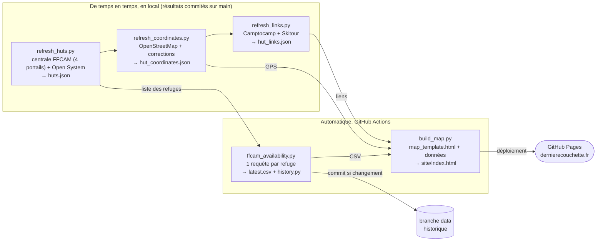

# Dernière couchette — handover

_État au 21/11/2026._

Dernière couchette est une carte des places libres dans les refuges de montagne pour le week-end en cours, en ligne sur [dernierecouchette.fr](https://dernierecouchette.fr/) et mise à jour automatiquement par GitHub Actions.

- **Couverture** : 140 refuges — 115 FFCAM, 9 + 12 du Parc national de la Vanoise, 3 du Néouvielle, le Gîte du Boréon.
- **Code** : Python standard sans dépendance + une page HTML Leaflet.
- **Fréquence** : toutes les heures en saison (déc.–avr., juin–sept.), une fois par jour sinon.
- **Historique** : chaque changement de places est conservé sur la branche `data`, pour de futures analyses (pas encore affiché).
- **État** : tout ce qui est décrit ici est en ligne ; voir [État en cours et prochaines étapes](#état-en-cours-et-prochaines-étapes).

## Sommaire

- [Architecture](#architecture)
- [Sources de données](#sources-de-données)
- [Récupérer les disponibilités : les requêtes](#récupérer-les-disponibilités--les-requêtes)
- [La carte](#la-carte)
- [Historique des disponibilités](#historique-des-disponibilités)
- [Mise en ligne](#mise-en-ligne)
- [Opérations courantes](#opérations-courantes)
- [État en cours et prochaines étapes](#état-en-cours-et-prochaines-étapes)
- [Pièges connus et décisions](#pièges-connus-et-décisions)

## Architecture

Deux rythmes : trois scripts « de référence » lancés à la main de temps en temps, et deux scripts lancés automatiquement à chaque relevé.



`ffcam.py` contient le code partagé (requêtes, portails, Open System) et `history.py` l'enregistrement de l'historique.

| Fichier | Contenu | Produit par | Versionné |
| --- | --- | --- | --- |
| `huts.json` | 140 refuges : id, nom, type, portail, site | `refresh_huts.py` | oui (main) |
| `hut_coordinates.json` | GPS, altitude, id OSM, site OSM | `refresh_coordinates.py` | oui (main) |
| `coordinates_overrides.json` | 6 corrections GPS faites à la main | à la main | oui (main) |
| `hut_links.json` | liens Camptocamp et Skitour | `refresh_links.py` | oui (main) |
| `map_template.html` | la carte (HTML, CSS, JS Leaflet) | à la main | oui (main) |
| `history/` | historique des places | `ffcam_availability.py` | oui (branche `data`) |
| `secrets.env` | clé Skitour (et IGN éventuelle) | à la main | **jamais** |
| `ffcam_*.csv`, `map.html`, `data/`, `site/` | sorties générées | scripts | non (`.gitignore`) |
| `deploy/` | plan B VPS OVH + nginx + certbot | — | oui, jamais utilisé |

## Sources de données

Les places viennent de deux systèmes de réservation publics, interrogés sans clé ; le reste (GPS, liens, fonds de carte) vient de services ouverts.

| Source | Ce qu'on en tire | Accès | Particularités |
| --- | --- | --- | --- |
| [Centrale FFCAM](https://centrale.ffcam.fr/index.php) | liste des refuges + places par nuit | sans clé | voir [les requêtes](#1-centrale-ffcam-portails-ffcam-vanoise-neouvielle-boreon) |
| Portails de la centrale (`apporigin`) | refuges hors liste FFCAM | sans clé | FFCAM (115), VANOISE (+9), NEOUVIELLE (+3), BOREON (+1). Disponibles non utilisés : ENTREPYRPYRENEES (52, Espagne/Andorre), ITFFCAM (tout + Maroc). |
| Open System (Alliance Réseaux) | 12 refuges du Parc de la Vanoise (Leisse, Fond des Fours…) | sans clé | voir [les requêtes](#2-open-system-12-refuges-du-parc-de-la-vanoise-portal--opensystem). **Pas de capacité.** |
| OpenStreetMap (Overpass) | GPS, altitude, site web | sans clé | Souvent surchargé : le script essaie 3 serveurs et réessaie (jusqu'à plusieurs minutes). Appariement par site `*.ffcam.fr`, puis par nom, puis corrections manuelles. |
| Nominatim (OSM) | recherche ponctuelle d'un refuge introuvable | sans clé | Utilisé à la main pour remplir `coordinates_overrides.json`. |
| [Camptocamp](https://www.camptocamp.org) | lien fiche refuge | API publique | Recherche dans un rayon de 1,5 km, acceptée si < 400 m ou nom proche. 136/140 trouvés. |
| [Skitour](https://skitour.fr/api/) | lien fiche refuge | clé perso (gratuite, 1000 req/j) | `GET /api/refuges` avec en-tête `cle`. 113/140 trouvés. Les conditions demandent un lien vers skitour.fr. |
| IGN Géoplateforme | fonds Plan IGN, traces ski de rando | sans clé | Couche `TRACES.RANDO.HIVERNALE` (rouge, recolorée en bleu en CSS). SCAN 25 = clé privée : code prêt, jamais testé. |
| Esri, OpenTopoMap, OSM France | fonds de carte | sans clé | `tile.openstreetmap.org` refuse les pages sans `Referer` (fichier local) : on utilise OSM France. CARTO exige désormais une clé : abandonné. |

## Récupérer les disponibilités : les requêtes

Deux systèmes, un appel par refuge et par relevé, choisi selon le champ `portal` du refuge dans `huts.json` (code : `fetch_availability()` dans `ffcam.py`). Aucun des deux ne demande de clé ni de cookie.

### 1. Centrale FFCAM (portails FFCAM, VANOISE, NEOUVIELLE, BOREON)

**Liste des refuges d'un portail** — GET, une fois par portail :

```
GET https://centrale.ffcam.fr/index.php?mode=FORM&_lang=FR&init=1&apporigin=FFCAM
```

La page HTML contient une ligne `structuresList = {"BK_STRUCTURE:85": {...}, ...};` (extraite par regex puis JSON) : `name`, `shortName`, `structureType`, `email` obfusqué, `maxPax`, `maxDays`, `bookingDelay`, `productsCategories`. Remplacer `apporigin` pour un autre portail ; un refuge présent dans plusieurs portails est gardé avec le premier de la liste.

**Places d'un refuge** — POST, formulaire :

```
POST https://centrale.ffcam.fr/index.php?
action=availability
apporigin=FFCAM            # un portail qui liste ce refuge
structure=BK_STRUCTURE:22
productCategory=nomatter   # tous types d'hébergement confondus
pax=1
date=2026-11-21            # aujourd'hui par défaut
```

La réponse est la page HTML du calendrier ; on en extrait trois objets JS (une ligne chacun) :

```
BK.availability      = {"2026-11-21": 24, ...}         # places libres
BK.totalAvailability = {"2026-11-21": 24, ...}         # capacité de la nuit
BK.openingCalendar   = {"2026-11-21": "OPEN", ...}     # OPEN | CLOSE | UNGUARDED | UNKNOW
```

- Couverture : le mois de `date` et le mois suivant, en entier. Pour un refuge pas encore réservable, le serveur décale souvent ces deux mois vers ses premières dates réservables.
- Demander avec un `apporigin` qui ne liste pas le refuge renvoie des données vides ou incohérentes : d'où le champ `portal`.
- Réservable = `opening == OPEN` et places > 0.

### 2. Open System (12 refuges du Parc de la Vanoise, `portal = OPENSYSTEM`)

**Découverte des refuges** (dans `refresh_huts.py`) : la page d'accueil de [refuge-leisse.vanoise.com](https://refuge-leisse.vanoise.com/) liste les autres refuges du Parc (`https://refuge-xxx.vanoise.com`). Sur chaque site, le widget de réservation porte l'id produit :

```
AllianceReseaux.Widget.Instance("Produit", { idPanier: "AGwCAAA", idIntegration: "1110", ui: "OPRF-92948" })
```

Pas d'`OPRF` sur la page = refuge qui réserve via la centrale FFCAM (Arpont, Orgère, Valette) : ignoré ici. L'id stocké dans `huts.json` est `OPRF-92948`.

**Places d'un refuge** — GET, réponse JSONP (le paramètre `callback` est facultatif) :

```
GET https://etape-rest.for-system.com/index.aspx/index.aspx?ref=json-planning-refuge&q=92948,2027-03-07

([{"id":92948,"datemini":"2026-11-24",
   "planning":[{"s":0,"f":1,"d":15}, ..., {"s":25,"f":0,"d":0}, ..., {"s":32,"f":0,"d":-14}]}])
```

- `planning` = 30 jours, **de q−15 à q+14** (q = la date demandée), du plus ancien au plus récent.
- Le jour d'une entrée = **q − d** (`d` = jours *avant* q : 15 pour le premier, 0 pour q, −14 pour le dernier).
- `s` = places libres ; `f` = 1 si fermé ; `datemini` = première date réservable. **Aucune capacité** : la carte affiche « N places » sans total.
- Le script demande q = aujourd'hui + 15, pour couvrir d'aujourd'hui à J+29 (les deux week-ends affichés y sont toujours).
- Vérifié sur la Leisse : fermé le 19/02/2027, ouvert le 20/02 avec 25 places, comme annoncé sur son site.

### Format commun en sortie

Les deux fonctions renvoient le même dictionnaire, ce qui permet au reste (CSV, historique, carte) de ne pas distinguer les systèmes :

```
{"free": {"2026-11-21": 24, ...}, "capacity": {"2026-11-21": 24 ou None, ...}, "opening": {"2026-11-21": "OPEN", ...}}
```

Pour ajouter un nouveau système : une fonction qui renvoie ce dictionnaire, un `portal` dédié dans `huts.json`, et une branche dans `fetch_availability()`.

## La carte

Une seule page HTML (`map_template.html` + les données injectées par `build_map.py`), Leaflet 1.9.4, sans serveur, design « Crêtes » : billets de couchette en papier crème, vert sapin, thème clair uniquement.

**Panneau de gauche** (feuille glissante en bas sur téléphone)

- En-tête : logo (lits superposés + étoile), titre, date de mise à jour, ligne de crêtes.
- Carrousel de nuits en billets : nuit choisie centrée, voisines à moitié visibles, samedi par défaut ; clic, flèches ← →, glissement au doigt.
- Chiffres clés (réservables, places, complets) : **limités au cadre de la carte**.
- Filtres : minimum de places, « Afficher les fermés » (complets + fermés), types Gardé / Non gardé / Autre (avec icônes ; clic sur un type quand tous sont actifs = ne garder que lui), recherche sans accents (un nom trouve le refuge même fermé ou hors du cadre).
- Liste des refuges **dans le cadre de la carte**, en petits billets ; clic = la carte vole au refuge.

**Carte**

- Marqueurs en talons de billet (places + pastille vert / orange / rouge), fermés = point gris.
- Fiche refuge : type, altitude, max par résa, une ligne par nuit, boutons Fiche FFCAM / Site du refuge / Réserver, Camptocamp, Skitour.
- Fonds : Topo clair Esri (défaut), OpenTopoMap, satellite Esri, Plan IGN, OSM France ; calque « Traces ski de rando (IGN) » ; SCAN 25 si clé IGN.
- Vue de départ : Alpes, du Léman aux Hautes-Alpes.

**Nuits affichées** : lundi–vendredi = vendredi, samedi, dimanche à venir ; samedi = ce soir + dimanche ; dimanche = ce soir ; bascule au week-end suivant le lundi.

**Mode caché « Avant-dernière couchette »** : clic sur le logo (ou `#avant-derniere` dans l'URL) = week-end suivant, en-tête teinté crépuscule, étoile retournée. Les données sont déjà dans la page (5 nuits par refuge le samedi).

**Téléphone** : tout le panneau défile d'un bloc avec un bandeau collant (titre + billets compacts), filtres repliés derrière « Filtres · n actifs », panneau jusqu'à 90 % de l'écran. Testé en simulation seulement, pas au doigt.

**Refuges sans capacité connue** (Open System) : affichés « 25 places » au lieu de « 25 / 32 ».

## Historique des disponibilités

Chaque relevé ajoute une ligne par changement de places, pour toutes les nuits à venir renvoyées (pas seulement le week-end) ; rien n'est encore affiché sur la carte.

- **Où** : branche `data` du dépôt ; en local, le dossier `history/` est un worktree git de cette branche.
- **Fichiers** : `availability_AAAA-MM.csv` (un par mois de relevé) et `state.json` (dernier état connu par refuge/nuit, une ligne par clé pour des diffs git légers ; les nuits passées en sont retirées).
- **Colonnes** : `fetched_at, hut_id, date, opening, free_beds, capacity` (heure de Paris).
- **Lire** : l'état d'une nuit à un instant = la dernière ligne avant cet instant pour ce `hut_id` et cette `date`.
- **Volume** : état initial 5 084 lignes (308 Ko) le 21/11/2026 ; ensuite quelques dizaines à centaines de lignes par jour attendues en saison (à confirmer).

**Limites**

- Fenêtre suivie : d'aujourd'hui à la fin du mois suivant (FFCAM) ou 30 jours (Open System). Les réservations plus lointaines ne sont vues qu'en entrant dans la fenêtre ; une 2e requête par refuge l'élargirait mais a été écartée (charge x2).
- FFCAM décale parfois la fenêtre vers les premières dates réservables d'un refuge : des nuits lointaines (jusqu'en juillet) apparaissent pour certains.
- Une requête en erreur n'enregistre rien (pas de faux « 0 place »).
- Relancer `ffcam_availability.py` en local sans `git pull` dans `history/` fait diverger l'historique : utiliser `--no-history` pour les tests.

## Mise en ligne

Le site est publié par GitHub Actions sur GitHub Pages, derrière le domaine dernierecouchette.fr acheté chez OVH, en HTTPS.

| Élément | Réglage |
| --- | --- |
| Dépôt | `jor-di/ffcam-huts`, public, branche par défaut `main` (obligatoire pour les tâches planifiées et la publication Pages) |
| Tâche | `.github/workflows/update.yml` : `7 * * 12,1-4,6-9 *` (saison) et `7 7 * 5,10,11 *` (hors saison), heures UTC ; aussi à chaque push sur `main` et via « Run workflow » ; `TZ=Europe/Paris` |
| Étapes | checkout `main` + checkout `data` dans `history/` → `ffcam_availability.py` → `build_map.py` → commit de `history/` si changement → déploiement Pages |
| Pages | Settings → Pages → Source = GitHub Actions ; Custom domain = `dernierecouchette.fr` ; « Enforce HTTPS » à cocher une fois le certificat prêt |
| DNS (OVH) | 4 × A `@` → `185.199.108-111.153`, 4 × AAAA `@` → `2606:50c0:8000-8003::153`, CNAME `www` → `jor-di.github.io.`, TXT `_github-pages-challenge-jor-di` (domaine vérifié) ; NS, MX et SPF d'origine conservés |
| Compte | GitHub perso `jor-di` ; sur la machine, clé SSH dédiée `~/.ssh/id_ed25519_github_perso` via l'alias `github-perso` ; identité perso automatique sous `~/code/perso/` (`includeIf`) ; le compte pro reste en HTTPS via `gh` |
| Secrets | `secrets.env` (local, `chmod 600`, ignoré par git) : `SKITOUR_API_KEY`, `IGN_API_KEY` (vide). Le workflow n'en a pas besoin. |

## Opérations courantes

Au quotidien il n'y a rien à faire : la tâche planifiée relève et publie seule. Les commandes se lancent à la racine du dépôt.

| Quand | Commande | Notes |
| --- | --- | --- |
| Modifier le code ou la carte | éditer, puis `git commit` + `git push` | le push relance un relevé et republie |
| Voir le résultat en local | `./ffcam_availability.py --no-history && ./build_map.py && xdg-open map.html` | `--no-history` évite de diverger de l'historique en ligne |
| Forcer une mise à jour en ligne | onglet Actions → « Update availability » → Run workflow | |
| Rafraîchir la liste des refuges (quelques fois par an) | `./refresh_huts.py && ./refresh_coordinates.py && ./refresh_links.py`, puis commit + push des JSON | Overpass peut prendre plusieurs minutes ; la clé Skitour est lue dans `secrets.env` |
| Un refuge n'a pas de GPS | ajouter une entrée dans `coordinates_overrides.json` (via Nominatim), relancer `refresh_coordinates.py` | 6 corrections aujourd'hui |
| Ajouter un portail de la centrale | `./refresh_huts.py --portals FFCAM VANOISE NEOUVIELLE BOREON OPENSYSTEM ENTREPYRPYRENEES` | ou modifier `DEFAULT_PORTALS` dans `ffcam.py` |
| Récupérer l'historique | `git pull` dans `history/` | avant tout relevé local avec historique |
| Tester une autre date | `./ffcam_availability.py --date 2027-02-20 --nights 2 --no-history` | |
| Ajouter la couche IGN SCAN 25 | remplir `IGN_API_KEY` dans `secrets.env`, puis `./build_map.py` | la clé finit en clair dans la page publiée |

## État en cours et prochaines étapes

Tout est publié (commit `01acb68`, 21/11/2026). Dernier lot mis en ligne :

- Mode « Avant-dernière couchette » (clic logo, `#avant-derniere`) et relevé des nuits du week-end suivant.
- Mise en page téléphone : panneau qui défile d'un bloc, filtres repliés, panneau à 90 %.
- 16 nouveaux refuges : Néouvielle (3), Boréon (1), Vanoise via Open System (12) — coordonnées (140/140) et liens rafraîchis.
- Gestion des refuges sans capacité connue dans la carte ; recherche par nom qui trouve aussi les refuges fermés ou hors cadre.

**À faire**

- [x] Vérifier le rendu des refuges Open System sur une date d'ouverture (`--date 2027-02-20` : Leisse 25 places, Bois 45, Femma 40, Vallonbrun 27)
- [x] Publier le lot ci-dessus et contrôler le premier relevé en ligne (140 refuges, 5 portails)
- [ ] Tester le panneau téléphone au doigt sur un vrai téléphone
- [ ] Cocher « Enforce HTTPS » dans Settings → Pages si ce n'est pas déjà fait
- [ ] Choisir le marqueur définitif (talon de billet retenu par défaut ; alternatives : silhouette de refuge, étoile)

**Pistes évoquées, non commencées**

- Afficher l'historique (courbes de remplissage, alertes « une place s'est libérée »).
- Ajouter ENTREPYRPYRENEES (52 refuges Pyrénées espagnoles/andorranes ; élargir la recherche OSM hors France).
- Refuges gardés du Mont-Blanc (Goûter, Tête Rousse) : système à part sur montblanc.ffcam.fr.
- Couche « cabanes et abris » depuis l'API refuges.info (sans disponibilités).
- Le petit chiffre sous chaque nuit du carrousel compte toute la France, pas le cadre.

## Pièges connus et décisions

**Pièges**

- Un refuge peut avoir des places libres et être fermé (`CLOSE`) : « réservable » = `OPEN` **et** places > 0.
- Les « Non Gardé » sont des entrées séparées de leur refuge gardé (salle hors-sac) ; en hiver ce sont presque les seuls réservables.
- Les emails des refuges sont obfusqués (`name<a></a><ff></ff>…`) : seule la partie avant @ est fiable ; elle donne le site `name.ffcam.fr`.
- Les tâches planifiées GitHub partent avec retard (minutes, parfois plus) et sont désactivées après 60 jours sans activité (les commits de données devraient suffire).
- Le dépôt peut être modifié directement sur GitHub (ça a été le cas du README) : faire `git pull --rebase` avant de pousser.
- Le Ratou n'a ni site ni position exacte (panneau « Chalet du Ratou ») ; Averole et Orédon sont tagués autrement qu'en refuge dans OSM.

**Décisions**

- Pas de base de données : fichiers JSON/CSV versionnés ; une base hébergée seulement si on affiche l'historique de façon interactive.
- Hébergement GitHub Pages plutôt qu'un VPS (gratuit, sans maintenance) ; dépôt public accepté.
- Une seule requête par refuge et par relevé (charge FFCAM ~3 000 requêtes/jour en saison) ; pas de 2e requête pour voir plus loin.
- Clés : la clé d'exemple de la doc Skitour et les accès privés IGN n'ont pas été utilisés ; uniquement des clés personnelles.
- Les noms « FFCAM » / « CAF » sont évités dans le nom du site (marques de la fédération).
