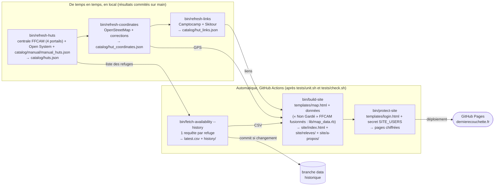

# Dernière couchette — handover

_État au 25/11/2026._

Dernière couchette est une carte des places libres dans les refuges de montagne pour le week-end en cours, en ligne sur [dernierecouchette.fr](https://dernierecouchette.fr/) et mise à jour automatiquement par GitHub Actions.

- **Couverture** : 174 refuges, venant de 5 systèmes de réservation (centrale FFCAM, Open System, Refuge Pro, WP Booking System) ou ajoutés à la main ; détail par refuge en [annexe](#annexe--source-de-chaque-refuge).
- **Code** : Ruby, bibliothèque standard seulement (aucune gem), scripts dans `bin/`, modules dans `lib/` + une page HTML Leaflet. Version : `.ruby-version` (4.0.10, utilisée par GitHub Actions) ; le code tourne aussi sur Ruby 3.1 à 3.3 (vérifié avec les tests).
- **Fréquence** (heure de Paris, lancé par cron-job.org) : de décembre à avril, toutes les heures à la minute 7 sauf de 1 h à 5 h ; de mai à novembre, une fois par jour à 7h07.
- **Historique** : chaque changement de places est conservé sur la branche `data`, pour de futures analyses (pas encore affiché).

## Sommaire

- [Architecture](#architecture)
- [Sources de données](#sources-de-données)
- [Récupérer les disponibilités : les requêtes](#récupérer-les-disponibilités--les-requêtes)
- [La carte](#la-carte)
- [Historique des disponibilités](#historique-des-disponibilités)
- [Mise en ligne](#mise-en-ligne)
- [Accès (prénom + mot de passe)](#accès-prénom--mot-de-passe)
- [Opérations courantes](#opérations-courantes)
- [Tests](#tests)
- [En suspens](#en-suspens)
- [Pièges connus et décisions](#pièges-connus-et-décisions)
- [Annexe : source de chaque refuge](#annexe--source-de-chaque-refuge)

## Architecture

Deux rythmes : trois scripts « de référence » lancés à la main de temps en temps, et deux scripts lancés automatiquement à chaque relevé.



Les scripts sont dans `bin/` et s'y lancent directement (`bin/<script>`, ligne `#!/usr/bin/env ruby`) ; le code qu'ils partagent est dans `lib/`. Ils lisent et écrivent leurs fichiers de données (`catalog/huts.json`, `history/`, `map.html`…) dans le dossier parent de `bin/` et `lib/`, la racine du dépôt, quel que soit le dossier courant ; seul le CSV par défaut de `bin/fetch-availability` (`availability_<date>.csv`) va dans le dossier courant : les lancer depuis la racine. Modules partagés : `lib/couchette.rb` (module `Couchette` : chemins, environnement, ligne de commande ; charge les autres), `lib/http.rb` (toutes les requêtes : politesse, essais, enregistrement / rejeu), `lib/clock.rb` (heure de Paris, `COUCHETTE_NOW`), `lib/sources.rb` (liste des refuges et aiguillage vers la source de chacun), `lib/sources/` (un fichier par système : `ffcam_centrale.rb`, `open_system.rb`, `refuge_pro.rb`, `wpbs.rb`), `lib/weekends.rb` (nuits du week-end affiché), `lib/history.rb` (historique), `lib/fetch_log.rb` (journal des relevés), `lib/map_data.rb` (parties non gardées FFCAM, pour la carte), `lib/py.rb` (formats d'écriture des fichiers, voir [décisions](#pièges-connus-et-décisions)), `lib/difflib.rb` (similarité des noms).

Rangement : `bin/` (scripts), `lib/` (code partagé), `catalog/` (listes de refuges produites par les `bin/refresh-*`), `catalog/manual/` (fichiers tenus à la main), `templates/` (pages HTML remplies par `bin/build-site` et `bin/protect-site`), `tests/`, `deploy/`.

| Fichier | Contenu | Produit par | Versionné |
| --- | --- | --- | --- |
| `catalog/huts.json` | 174 refuges : id, nom, type, portail, site (dont 28 « Non Gardé » FFCAM, fusionnés sur la carte : 151 marqueurs) | `bin/refresh-huts` | oui (main) |
| `catalog/hut_coordinates.json` | GPS, altitude, id OSM, site OSM | `bin/refresh-coordinates` | oui (main) |
| `catalog/manual/coordinates_overrides.json` | 6 corrections GPS faites à la main | à la main | oui (main) |
| `catalog/manual/manual_huts.json` | refuges ajoutés à la main : position, site, téléphone, email, et `refugepro` (slug du calendrier) ou `wpbs` (pages du calendrier WordPress) s'ils en ont un | à la main | oui (main) |
| `catalog/hut_links.json` | liens Camptocamp et Skitour | `bin/refresh-links` | oui (main) |
| `templates/map.html` | la carte (HTML, CSS, JS Leaflet) | à la main | oui (main) |
| `history/` | historique des places + `fetch_log.json` (journal des relevés) | `bin/fetch-availability --history` | oui (branche `data`) |
| `templates/releves.html` | page de suivi des relevés | à la main | oui (main) |
| `catalog/manual/booking_links.json` | liens « Site du refuge » / « Résa » (icône calendrier) qu'on ne peut pas deviner (voir [La carte](#la-carte)) | à la main | oui (main) |
| `templates/a-propos.html` | page « À propos » pour le grand public (démarche, lecture de la carte, sources avec le nombre de refuges calculé à chaque build, lien GitHub) | à la main | oui (main) |
| `templates/login.html` | écran de connexion qui enveloppe chaque page publiée (voir [Accès](#accès-prénom--mot-de-passe)) | à la main | oui (main) |
| `secrets.env` | clé Skitour (et IGN éventuelle) | à la main | **jamais** |
| `.ruby-version` | version de Ruby (GitHub Actions, mise / rbenv en local) | à la main | oui (main) |
| `tests/` | tests unitaires et rejeu hors ligne (voir [Tests](#tests)) | à la main | oui (main) |
| `availability_*.csv`, `map.html`, `releves/`, `a-propos/`, `data/`, `site/` | sorties générées | scripts | non (`.gitignore`) |
| `deploy/` | plan B VPS OVH + nginx + certbot | — | oui, jamais utilisé |

## Sources de données

Les places viennent de quatre systèmes de réservation, lus là où les refuges les publient eux-mêmes, sans clé ; le reste (GPS, liens, fonds de carte) vient de services ouverts.

| Source | Ce qu'on en tire | Accès | Particularités |
| --- | --- | --- | --- |
| [Centrale FFCAM](https://centrale.ffcam.fr/index.php) | liste des refuges + places par nuit | sans clé | voir [les requêtes](#1-centrale-ffcam-portails-ffcam-vanoise-neouvielle-boreon) |
| Portails de la centrale (`apporigin`) | refuges hors liste FFCAM | sans clé | FFCAM (115), VANOISE (+9), NEOUVIELLE (+3), BOREON (+1). Disponibles non utilisés : ENTREPYRPYRENEES (52, Espagne/Andorre), ITFFCAM (tout + Maroc). |
| Open System (Alliance Réseaux) | 12 refuges du Parc de la Vanoise (Leisse, Fond des Fours…) + 20 refuges ajoutés à la main (Goléon, Glière, Requin, Queyras, Haut-Giffre, Pyrénées… voir [annexe](#open-system-parc-de-la-vanoise-et-ajoutés-à-la-main)) | sans clé | voir [les requêtes](#2-open-system-12-refuges-du-parc-de-la-vanoise-portal--opensystem). **Pas de capacité.** |
| [Refuge Pro](https://refuge-pro.com) | 11 refuges privés (Clarée, Vallée Étroite, Galibier, Maurienne…) : places, capacité, liste d'attente | sans clé | Calendrier « embed » que chaque refuge intègre à son site ; voir [les requêtes](#3-refuge-pro-11-refuges-portal--refugepro). ~1 an de nuits. |
| WP Booking System | Refuge de la Coire : places par nuit | sans clé | Extension WordPress dont le calendrier est dans la page du site du refuge ; voir [les requêtes](#4-wp-booking-system-refuge-de-la-coire-portal--wpbs). Deux mois (le mois en cours et le suivant). **Pas de capacité.** |
| OpenStreetMap (Overpass) | GPS, altitude, site web | sans clé | Souvent surchargé : le script essaie 3 serveurs et réessaie (jusqu'à plusieurs minutes). Appariement par site `*.ffcam.fr`, puis par nom, puis corrections manuelles. |
| Nominatim (OSM) | recherche ponctuelle d'un refuge introuvable | sans clé | Utilisé à la main pour remplir `catalog/manual/coordinates_overrides.json`. |
| [Camptocamp](https://www.camptocamp.org) | lien fiche refuge | API publique | Recherche dans un rayon de 1,5 km, acceptée si < 400 m ou nom proche. 168/174 trouvés. |
| [Skitour](https://skitour.fr/api/) | lien fiche refuge | clé perso (gratuite, 1000 req/j) | `GET /api/refuges` avec en-tête `cle`. 140/174 trouvés. Les conditions demandent un lien vers skitour.fr. |
| IGN Géoplateforme | fonds Plan IGN, traces ski de rando | sans clé | Couche `TRACES.RANDO.HIVERNALE` (rouge, recolorée en bleu en CSS). SCAN 25 = clé privée : code prêt, jamais testé. |
| Esri, OpenTopoMap, OSM France | fonds de carte | sans clé | `tile.openstreetmap.org` refuse les pages sans `Referer` (fichier local) : on utilise OSM France. CARTO exige désormais une clé : abandonné. |

## Récupérer les disponibilités : les requêtes

Quatre systèmes, un appel par refuge et par relevé (par page pour WP Booking System), choisi selon le champ `portal` du refuge dans `catalog/huts.json` (code : `Couchette.fetch_availability` dans `lib/sources.rb`, un fichier par système dans `lib/sources/`). Aucun ne demande de clé ni de cookie. Les requêtes passent toutes par `Couchette.polite` : 2 simultanées au plus et 0,3 s entre deux départs par site.

### 1. Centrale FFCAM (portails FFCAM, VANOISE, NEOUVIELLE, BOREON)

**Liste des refuges d'un portail** — GET, une fois par portail :

```
GET https://centrale.ffcam.fr/index.php?mode=FORM&_lang=FR&init=1&apporigin=FFCAM
```

La page HTML contient une ligne `structuresList = {"BK_STRUCTURE:85": {...}, ...};` (extraite par regex puis JSON) : `name`, `shortName`, `structureType`, `email` obfusqué, `maxPax`, `maxDays`, `bookingDelay`, `productsCategories`. Remplacer `apporigin` pour un autre portail ; un refuge présent dans plusieurs portails est gardé avec le premier de la liste.

**Places d'un refuge** — POST, formulaire :

```
POST https://centrale.ffcam.fr/index.php?
action=availability
apporigin=FFCAM            # un portail qui liste ce refuge
structure=BK_STRUCTURE:22
productCategory=nomatter   # tous types d'hébergement confondus
pax=1
date=2026-11-21            # aujourd'hui par défaut
```

La réponse est la page HTML du calendrier ; on en extrait trois objets JS (une ligne chacun) :

```
BK.availability      = {"2026-11-21": 24, ...}         # places libres
BK.totalAvailability = {"2026-11-21": 24, ...}         # capacité de la nuit
BK.openingCalendar   = {"2026-11-21": "OPEN", ...}     # OPEN | CLOSE | UNGUARDED | UNKNOW
```

- Couverture : le mois de `date` et le mois suivant, en entier. Pour un refuge pas encore réservable, le serveur décale souvent ces deux mois vers ses premières dates réservables.
- Demander avec un `apporigin` qui ne liste pas le refuge renvoie des données vides ou incohérentes : d'où le champ `portal`.
- Réservable = `opening == OPEN` et places > 0.

### 2. Open System (12 refuges du Parc de la Vanoise, `portal = OPENSYSTEM`)

**Découverte des refuges** (dans `bin/refresh-huts`, via `Couchette.fetch_opensystem_huts`) : la page d'accueil de [refuge-leisse.vanoise.com](https://refuge-leisse.vanoise.com/) liste les autres refuges du Parc (`https://refuge-xxx.vanoise.com`). Sur chaque site, le widget de réservation porte l'id produit :

```
AllianceReseaux.Widget.Instance("Produit", { idPanier: "AGwCAAA", idIntegration: "1110", ui: "OPRF-92948" })
```

Pas d'`OPRF` sur la page = refuge qui réserve via la centrale FFCAM (Arpont, Orgère, Valette) : ignoré ici. L'id stocké dans `catalog/huts.json` est `OPRF-92948`.

**Places d'un refuge** — GET, réponse JSONP (le paramètre `callback` est facultatif) :

```
GET https://etape-rest.for-system.com/index.aspx/index.aspx?ref=json-planning-refuge&q=92948,2027-03-07

([{"id":92948,"datemini":"2026-11-24",
   "planning":[{"s":0,"f":1,"d":15}, ..., {"s":25,"f":0,"d":0}, ..., {"s":32,"f":0,"d":-14}]}])
```

- `planning` = 30 jours, **de q−15 à q+14** (q = la date demandée), du plus ancien au plus récent.
- Le jour d'une entrée = **q − d** (`d` = jours *avant* q : 15 pour le premier, 0 pour q, −14 pour le dernier).
- `s` = places libres ; `f` = 1 si fermé ; `datemini` = première date réservable. **Aucune capacité** : la carte affiche « N places » sans total.
- Le script demande q = aujourd'hui + 15, pour couvrir d'aujourd'hui à J+29 (les deux week-ends affichés y sont toujours).
- Vérifié sur la Leisse : fermé le 19/02/2027, ouvert le 20/02 avec 25 places, comme annoncé sur son site.

### Format commun en sortie

Les méthodes de chaque système renvoient le même hash, ce qui permet au reste (CSV, historique, carte) de ne pas distinguer les systèmes :

```
{"free": {"2026-11-21": 24, ...}, "capacity": {"2026-11-21": 24 ou None, ...}, "opening": {"2026-11-21": "OPEN", ...}}
```

Pour ajouter un nouveau système : un fichier dans `lib/sources/` (chargé par `lib/couchette.rb`) avec une méthode de `Couchette` qui renvoie ce hash, un `portal` dédié dans `catalog/huts.json`, et une branche dans `Couchette.fetch_availability` (`lib/sources.rb`).

### Mode de réservation d'une nuit (`booking`)

La centrale FFCAM dit aussi, nuit par nuit, **comment** réserver, via les classes CSS des cases du calendrier renvoyé (`<div class="day …"><a data-date="2026-12-12" …>`, lu par `Couchette.booking_modes`) :

| Classe de la case | `booking` | Signification |
| --- | --- | --- |
| `day dispo` | `online` | réservable en ligne |
| `day complet waitinglistday` | `waitlist` | complet, inscription en liste d'attente possible |
| `day completWeb completWebInfo` | `phone` | plus vendu en ligne (souvent ce soir, après le délai de réservation) : « Réserver par téléphone / mail » |

Refuge Pro fournit l'équivalent, WP Booking System en partie (voir plus bas). Les refuges `MANUAL` ne sont pas interrogés : toutes leurs nuits valent `request`. Open System ne fournit pas cette information.

| Source | `online` | `waitlist` | `phone` | `request` |
| --- | --- | --- | --- | --- |
| Centrale FFCAM | `day dispo` | `waitinglistday` | `completWeb` | — |
| Refuge Pro | places > 0 | complet + `waitlistEnabled` | délai dépassé, saison pas encore ouverte | — |
| WP Booking System | réservable, « N pl. » affiché | — | — | réservable sans nombre de places affiché |
| Open System | — (rien) | — | — | — |
| `MANUAL` | — | — | — | toutes les nuits |

### 3. Refuge Pro (11 refuges, `portal = REFUGEPRO`)

Refuge Pro est le logiciel de réservation que ces refuges utilisent ; il fournit un calendrier à intégrer dans le site du refuge. On lit cette page « embed » (pas la vitrine tierce refuge.camp, ni son API) :

```
GET https://refuge-pro.com/embed/calendrier/refuge-de-terre-rouge
```

C'est une page Next.js : ses données sont dans des blocs `self.__next_f.push([1,"…"])`. Une fois concaténés et décodés, on y trouve un objet JSON `"availability": {…}` (lu avec `Py.raw_decode`, qui lit un objet JSON à partir d'une position et ignore la suite) :

```
{"defaultCapacity":35, "bookingCutoffDays":1, "waitlistEnabled":true,
 "nextSeasonOpening":{"premiereNuit":"2027-06-12","ouvreLe":"2027-01-15"},
 "openingRanges":[{"from":"2027-01-09","to":"2027-04-10"}, …],
 "data":[{"date":"2027-01-23","capacity":35,"booked":35,"free":0,"status":"open","isFull":true}, …]}
```

- `data` couvre **environ un an** (346 nuits), avec capacité, réservé et libre par nuit. Un jour ouvert avec `"unguarded": true` (réservable sans gardien : Ricou jusqu'au 25/12/2026, par exemple) donne `UNGUARDED` au lieu de `OPEN`, places et mode de réservation gardés : « Non gardé » sur la carte, réservable dans le CSV.
- `booking` : complet + `waitlistEnabled` → `waitlist` ; nuit avant aujourd'hui + `bookingCutoffDays`, ou au-delà de `premiereNuit` tant que `ouvreLe` n'est pas passé → `phone` (places mises à 0) ; sinon `online`.
- Le slug est l'adresse du calendrier ; il est noté dans `catalog/manual/manual_huts.json` (champ `refugepro`). Il n'y a pas de liste publique des refuges Refuge Pro : les 11 slugs ont été trouvés en essayant le nom du refuge (`chardonnet`, `refuge-du-clot-des-vaches`…) ; une page inexistante répond 404.
- La page donne aussi le téléphone du refuge (`telephoneRefuge`) mais **pas sa position** : position et altitude viennent d'OpenStreetMap (Nominatim), notées dans `catalog/manual/manual_huts.json`.
- Sur la carte : ce calendrier = bouton « Résa » (icône calendrier) ; le site propre du refuge (champ `website`, quand il existe) = bouton « Site du refuge ».
- **Pas de vitrine tierce** : ces refuges sont aussi vendus sur refuge.camp (même éditeur), qu'on n'utilise pas ; on lit le calendrier du refuge.

### 4. WP Booking System (Refuge de la Coire, `portal = WPBS`)

[WP Booking System](https://www.wpbookingsystem.com/) (extension WordPress « wp-booking-system-premium ») affiche un calendrier dans une page du site du refuge. Le calendrier est rendu côté serveur, dans le HTML de la page :

```
GET https://www.refugedelacoire.fr/reservations-hiver/

<div class="wpbs-container ... wpbs-calendar-12 " data-id="12" data-months_to_show="2"
     data-current_year="2026" data-current_month="11" data-changeover_start="58" data-changeover_end="59" ...>
  <div class="wpbs-date wpbs-legend-item-66 wpbs-is-bookable " data-year="2026" data-month="11" data-day="28" ...>
     ... <span class="wpbs-inventory">1 pl.</span> ...
  ...
  <div class="wpbs-legend"><div class="wpbs-legend-item"><div class="wpbs-legend-item-icon wpbs-legend-item-icon-66" ...>
     <span class=wpbs-legend-item-name>Disponible (non-gardé)</span></div> ...
```

- Une case par jour : `wpbs-legend-item-<n>` = l'état du jour, `wpbs-is-bookable` = sélectionnable, `wpbs-inventory` = places restantes (« N pl. », ou `wpbs-full` « Complet » ; souvent absent sur les jours passés).
- Les noms des états sont lus dans la légende du calendrier (les numéros changent d'un site et d'un calendrier à l'autre) et classés par sens (`Couchette.wpbs_meaning`) : « Disponible… » = disponible, « Complet » = complet, « Non-disponible », « Voir refuge été », « Fermé » = fermé. Coire, calendrier 12 : 56 « Disponible (selon conditions) », 66 « Disponible (non-gardé) », 57 « Complet », 60 « Voir refuge été », 67 « Non-disponible » ; 58 et 59 (`data-changeover_start` / `_end`, absents de la légende) = début et fin d'une réservation sur plusieurs jours : la nuit du début est prise, celle de la fin est libre.
- Règles (`Couchette.parse_wpbs`), dans l'ordre, jours passés ignorés : inventaire « Complet » ou « 0 pl. » → `OPEN`, 0 place (complet) ; état fermé → `CLOSE` ; réservable avec « N pl. » → `OPEN`, N places, `online` ; état complet (dont début de réservation) → `OPEN`, 0 ; non réservable → `CLOSE` ; **réservable sans nombre de places affiché → `OPEN`, places inconnues (vide), `request`** (affiché « Sur demande » : on sait que la nuit est ouverte, pas combien il reste de places). « Disponible (non-gardé) » (`Couchette.wpbs_meaning` → `:unguarded`) donne `UNGUARDED` au lieu de `OPEN` sur un jour réservable : la carte l'affiche « Non gardé » avec ses places (`night()` : `UNGUARDED` + un mode de réservation), et le CSV le compte réservable. À la Coire, la réservation est obligatoire toute l'année : l'encart FFCAM « lit non garanti » ne s'affiche que pour les refuges de la centrale.
- Pas de capacité (comme Open System) : la carte affiche « N places » sans total.
- Couverture : les mois présents dans la page seulement (Coire : le mois en cours et le suivant, assez pour les deux week-ends affichés). Les autres mois sont chargés par le site via `admin-ajax.php` : non utilisé.
- Page sans calendrier `wpbs-container`, ou calendrier sans aucune case datée → erreur (`err` sur `/releves/`, « RuntimeError: no WP Booking System calendar on <url> » / « no day in the WP Booking System calendar of <url> »).
- Configuration dans `catalog/manual/manual_huts.json`, champ `wpbs` : une liste de pages `[{"url": "…", "calendars": [14]}]` (`calendars` facultatif : sinon tous les calendriers de la page) ; un jour présent dans plusieurs calendriers ou pages est pris dans le premier. Une requête par page.
- **Été pas encore lu** : la page [réservations été](https://www.refugedelacoire.fr/reservations-ete/) a deux calendriers (14 et 15, à partir de juin 2027, autres numéros d'états : 70, 74, 76, 80). Il suffira d'ajouter la page à `wpbs` quand on saura comment combiner ses deux calendriers (aujourd'hui : le premier l'emporte, sans addition des places).
- Sur la carte : la page de réservation = bouton « Résa » (icône calendrier) ; le site du refuge (champ `website`) = « Site du refuge ».

### 5. Refuges sans réservation en ligne lisible (`portal = MANUAL`)

Nant du Beurre, Selle : ajoutés à la main dans `catalog/manual/manual_huts.json`, avec position (refuges.info), site, téléphone et email pris sur leur propre site. Pas de requête : leurs nuits valent `request` pendant leurs saisons de gardiennage (`"guarded"`), `CLOSE` en dehors (refuge d'hiver seulement).

**Saisons de gardiennage (`"guarded"`)** : liste de périodes `[["MM-DD", "MM-DD"], ...]`, bornes comprises, une période pouvant passer le nouvel an (`["12-12", "03-28"]`) ; testée par `Couchette.guarded_on?` (`lib/sources.rb`). Deux usages : un refuge sans réservation en ligne (`MANUAL`) est fermé hors saison au lieu d'être « sur demande » ; un refuge Open System dont le widget vend aussi les nuits non gardées (la Glière) a ces nuits relevées `UNGUARDED` (« Non gardé », lit non garanti). Les dates changent un peu chaque année : à revoir (voir [En suspens](#en-suspens)).

## La carte

Une seule page HTML (`templates/map.html` + les données injectées par `bin/build-site`), Leaflet 1.9.4, sans serveur, design « Crêtes » : billets de couchette en papier crème, vert sapin, thème clair uniquement.

**Panneau de gauche** (feuille glissante en bas sur téléphone)

- En-tête : logo (lits superposés + étoile), titre, date de mise à jour (lien vers /releves/), lien « à propos » (/a-propos/, page `templates/a-propos.html` écrite par `bin/build-site`), ligne de crêtes.
- Carrousel de nuits en billets : nuit choisie centrée, voisines à moitié visibles, samedi par défaut ; clic, flèches ← →, glissement au doigt.
- Chiffres clés « Sur la carte » (refuges réservables, places libres) : **limités au cadre de la carte**.
- Filtres : minimum de places (ne porte que sur les réservables), « Afficher les complets » (interrupteur coché par défaut, agit aussi sur les listes d'attente ; n'apparaît que si, cette nuit, au moins un refuge est complet ou en liste d'attente ; décoché, ils deviennent des points gris comme les fermés et passent en fin de liste ; bulle et fiche disent toujours ce qu'ils sont), types Gardé / Non gardé / Autre (selon la nuit choisie : « Non gardé » = la partie non gardée est affichée cette nuit, ou refuge non gardé seul ; les refuges fermés restent dans « Gardé » ; « Autre » = chalets, centres ; avec icônes ; clic sur un type quand tous sont actifs = ne garder que lui), recherche sans accents (un nom trouve le refuge même fermé ou hors du cadre).
- Liste des refuges **dans le cadre de la carte**, en petits billets ; clic = la carte vole au refuge.

**Carte**

- Marqueurs en talons de billet (places + pastille vert / orange / rouge, sablier violet pour la liste d'attente, ☎ pour téléphone / mail), fermés = point gris. Les refuges `MANUAL` (téléphone / mail seulement, jamais réservables en ligne) sont aussi un simple point gris sur la carte, mais restent « Sur demande » dans la liste et la fiche. Une nuit `UNGUARDED` de la centrale (refuge ouvert sans gardien) est libellée « Accès libre ».
- Fiche refuge : type, altitude, max par résa, une ligne par nuit, boutons « Site du refuge » et « Résa » (icône calendrier), puis Camptocamp, Skitour. Ni téléphone ni mail : le site n'est pas un annuaire, on renvoie vers le site du refuge (les contacts restent dans `catalog/` et le CSV, pas dans la carte). Les deux liens sont calculés par `MapData.links` (`lib/map_data.rb`) :
  - **Site du refuge** : le vrai site du refuge, champ `website` de `catalog/manual/manual_huts.json` (refuges Refuge Pro, Coire, Selle), sinon le site FFCAM (`<nom>.ffcam.fr`), Open System ou OSM. Jamais refuge-pro.com : sans `website`, pas de bouton. Les 11 refuges Refuge Pro ont un `website` (Marches et Chardonnet : leur page sur refugesclareethabor.com ; le Chardonnet a aussi un site en construction, refugechardonnet.wpcomstaging.com, à reprendre quand il aura une vraie adresse).
  - **Résa (icône calendrier)** (vérifié le 23/11/2026) : d'abord `catalog/manual/booking_links.json` (fait à la main : 19 refuges dont on ne peut pas deviner la page) ; sinon `<nom>.ffcam.fr/reservation.html` (widget de la centrale, refuge déjà choisi ; 80 sites sur 85 ; Platé, Étang Fourcat, Brèche de Roland, Lavey : page d'information ou fermeture pour travaux) ; pour une partie « Non Gardé », `reservation-hg.html` sur le site de son refuge gardé (widget `mode:'FORM_BOOK_HG'` avec l'id du **gardé**, que la centrale traduit en id de la partie non gardée ; alias `reservation-hors-gardiennage.html`) ; le calendrier Refuge Pro ou la page WP Booking System (`site` de `catalog/huts.json`) ; le site Open System (widget sur l'accueil) ; rien pour les refuges `MANUAL` ; en dernier recours le **lien direct de la centrale** `https://centrale.ffcam.fr/index.php?structure=<id>&mode=FORM&_lang=FR&init=1` (+ `&apporigin=VANOISE|NEOUVIELLE|BOREON` hors portail FFCAM ; marche pour tout id, page brute faite pour une iframe). Quand la nuit choisie montre la partie non gardée d'un refuge fusionné, le bouton mène à sa réservation (`winterBooking`).
  - `catalog/manual/booking_links.json` contient : Goûter et Tête Rousse non gardés (`montblanc.ffcam.fr/reservation-hg-vnmb.html`, page commune de la voie normale), Argentière et Leschaux non gardés (leur refuge gardé n'est pas dans la centrale ; `refugeleschaux`, pas `refugedeleschaux`), le site de l'Alpe de Villar d'Arène, le Sancy (pas de `reservation.html` : lien direct), et les fiches des portails Vanoise (refuges-vanoise.com), Néouvielle (visit-neouvielle.com) et Boréon (giteduboreon.com), qui portent le widget avec l'id du refuge (souvent sans le préfixe `BK_STRUCTURE:`).
- Fonds : Topo clair Esri (défaut), OpenTopoMap, satellite Esri, Plan IGN, OSM France ; calque « Traces ski de rando (IGN) » ; SCAN 25 si clé IGN.
- Vue de départ : Alpes, du Léman aux Hautes-Alpes.

**Nuits affichées** : lundi–vendredi = vendredi, samedi, dimanche à venir ; samedi = ce soir + dimanche ; dès le dimanche = vendredi, samedi, dimanche du week-end suivant.

**Mode caché « Avant-dernière couchette »** : clic sur le logo (ou `#avant-derniere` dans l'URL) = week-end suivant, en-tête teinté crépuscule, étoile retournée. Les données sont déjà dans la page (5 nuits par refuge le samedi).

**Téléphone** : tout le panneau défile d'un bloc avec un bandeau collant (titre + billets compacts), filtres repliés derrière « Filtres · n actifs », panneau jusqu'à 90 % de l'écran. Testé en simulation seulement, pas au doigt.

**Gardé / non gardé, une propriété de la nuit** : un seul marqueur par bâtiment (`templates/map.html`, `night()` ; données préparées par `lib/map_data.rb`). Pour chaque nuit :

1. le refuge gardé s'il est ouvert (réservable, sur demande ou complet) ;
2. sinon sa partie non gardée FFCAM si elle a des places : la centrale vend les « X Non Gardé » sous un id à part ; `MapData.merge_winter_rooms` les range dans leur refuge gardé (même nom après `Couchette.norm`) sous `nights[date].winter`. Sans refuge gardé dans la liste (Goûter, Tête Rousse, Argentière, Leschaux, Platé), la partie non gardée reste un refuge à part ;
3. sinon fermé. Beaucoup de refuges fermés gardent un accès libre (salle hors-sac, parfois nuitée à payer après coup, comme au Parc de la Vanoise) : ils restent affichés comme les autres fermés, par souci de cohérence.

Les nuits du cas 2 sont marquées « Non gardé » (icône à étoile, sous-titre « non gardé ») ; la fiche ajoute alors l'encart « Non gardé : réservation conseillée, lit non garanti. », d'après le [mode d'emploi hors gardiennage](https://www.ffcam.fr/periode-hors-gardiennage.html) de la FFCAM (repris dans un encart de la page « À propos »).

Où se fait la réconciliation : **uniquement à la construction de la carte**. `catalog/huts.json`, les relevés (`bin/fetch-availability`), le CSV et l'historique (branche `data`) gardent les deux ids FFCAM comme deux refuges distincts ; `bin/build-site` appelle `MapData.merge_winter_rooms` sur les données du CSV, qui retire l'entrée « Non Gardé » de la liste et range ses nuits dans le refuge gardé (`winter` par nuit, `winterId` sur le refuge) ; la page choisit ensuite nuit par nuit (`night()`). Le rapprochement se fait par le nom (`Couchette.norm` enlève « Non Gardé », « Refuge », les articles…) : si la FFCAM renomme l'un des deux, la paire n'est plus reconnue et les deux réapparaissent comme deux marqueurs (rien ne casse, mais vérifier après un `bin/refresh-huts`).

**Refuges sans capacité connue** (Open System, WP Booking System) : affichés « 25 places » au lieu de « 25 / 32 ».

**Catégorie « Sur demande »** (violet, affichée par défaut avec les réservables) : nuits FFCAM en liste d'attente (marqueur sablier) ou à réserver par téléphone / mail (`☎`), refuges `MANUAL` de `catalog/manual/manual_huts.json` (`☎`), et nuits WP Booking System réservables sans nombre de places affiché. La fiche donne le téléphone et l'email quand on les connaît. Les chiffres clés comptent « réservables / places » ; tous les refuges sont affichés, complets et fermés compris : les fermés, inutiles pour réserver, en petits points gris sous les autres marqueurs et en fin de liste, après les complets.

## Suivi des relevés (`/releves/`)

Une page publique, [dernierecouchette.fr/releves/](https://dernierecouchette.fr/releves/) (lien sur la date de mise à jour de la carte), dit si la récupération des places s'est bien passée pour chaque refuge au dernier relevé.

- **Production** : à chaque relevé, `bin/fetch-availability --history` appelle `FetchLog.record` (module `lib/fetch_log.rb`), qui classe chaque refuge et met à jour `history/fetch_log.json` sur la branche `data`. `bin/build-site` génère ensuite la page à partir de `templates/releves.html`, dans `releves/index.html` à côté de la carte (`site/releves/` en ligne).
- **États** : `ok` (nuits reçues ; une remarque si aucun calendrier d'ouverture n'est publié, normal pour un refuge fermé), `warn` « à vérifier » (réponse sans aucune nuit : souvent un changement de format), `err` (requête en échec : délai, erreur HTTP, page sans données ; le message de l'exception est gardé), `skip` « non relevé » (refuges `MANUAL`).
- **`fetch_log.json`** : `last_run` (le dernier relevé, une entrée par refuge : état, nuits reçues, durée, message), `runs` (les 48 derniers relevés résumés par source, avec la liste des refuges en problème), `last_success` (dernier relevé réussi par refuge). Le déclencheur vient du champ `source` de `workflow_dispatch` (« cron-job.org »), sinon de `GITHUB_EVENT_NAME` (push, manuel) ou vaut « local ».
- **Page** : le dernier relevé (durée, nombre de requêtes, déclencheur, résumé), un billet par source (refuges sans erreur / total, 24 derniers relevés en barres, durée cumulée, dernier succès), puis le tableau des refuges filtrable (À traiter, Erreurs, Remarques, Non relevés, Tous) avec recherche.
- **Effet de bord** : ce fichier change à chaque relevé, donc la branche `data` reçoit un commit par relevé (et non plus seulement en cas de changement de places).
- Sans `--history` (tout lancement à la main), le journal n'est pas écrit non plus ; `--log <fichier>` permet de l'écrire ailleurs pour tester.

## Historique des disponibilités

Chaque relevé ajoute une ligne par changement de places, pour toutes les nuits à venir renvoyées (pas seulement le week-end) ; rien n'est encore affiché sur la carte.

- **Où** : branche `data` du dépôt ; en local, le dossier `history/` est un worktree git de cette branche.
- **Qui écrit** : seulement `bin/fetch-availability --history`, que passent le workflow et `deploy/run_update.sh`. Sans cette option (défaut), le script n'écrit ni l'historique ni le journal des relevés : un lancement à la main ne touche jamais `history/`. (`--no-history` est encore accepté et ne fait rien.) Le dossier est toujours `history/` à côté de `rb/` : une copie du projet a son propre `history/`.
- **Fichiers** : `availability_AAAA-MM.csv` (un par mois de relevé) et `state.json` (dernier état connu par refuge/nuit, une ligne par clé pour des diffs git légers ; les nuits passées en sont retirées).
- **Colonnes** : `fetched_at, hut_id, date, opening, free_beds, capacity` (heure de Paris).
- **Lire** : l'état d'une nuit à un instant = la dernière ligne avant cet instant pour ce `hut_id` et cette `date`.
- **Volume** : état initial 5 084 lignes (308 Ko) le 21/11/2026 ; ensuite quelques dizaines à centaines de lignes par jour attendues en saison (à confirmer).

**Limites**

- Fenêtre suivie : d'aujourd'hui à la fin du mois suivant (FFCAM, WP Booking System) ou 30 jours (Open System). Les réservations plus lointaines ne sont vues qu'en entrant dans la fenêtre ; une 2e requête par refuge l'élargirait mais a été écartée (charge x2).
- FFCAM décale parfois la fenêtre vers les premières dates réservables d'un refuge : des nuits lointaines (jusqu'en juillet) apparaissent pour certains.
- Une requête en erreur n'enregistre rien (pas de faux « 0 place »).
- Lancer `bin/fetch-availability --history` en local sans `git pull` dans `history/` fait diverger l'historique : ne le faire que volontairement, après `git pull`.

## Mise en ligne

Le site est publié par GitHub Actions sur GitHub Pages, derrière le domaine dernierecouchette.fr acheté chez OVH, en HTTPS.

| Élément | Réglage |
| --- | --- |
| Dépôt | `jor-di/ffcam-huts`, public, branche par défaut `main` (obligatoire pour la publication Pages et `workflow_dispatch`) |
| Déclenchement | cron-job.org appelle `workflow_dispatch` (voir ci-dessous) ; pas de planning GitHub |
| Tâche | `.github/workflows/update.yml` : lancé par cron-job.org (`workflow_dispatch`) et via « Run workflow » (relevé + publication), et à chaque push sur `main` (publication seule, à partir du dernier relevé : ~30 s) ; `TZ=Europe/Paris` |
| Étapes | checkout `main` → Ruby (`ruby/setup-ruby@v1`, version de `.ruby-version`) → `tests/unit.sh` + `tests/check.sh` (un échec arrête tout, avant l'historique et Pages) → checkout `data` dans `history/` → `bin/fetch-availability --history` (sauf sur un push : le dernier relevé est repris du cache Actions, où chaque relevé range son CSV ; relevé quand même si le cache est vide) → `bin/build-site` → commit de `history/` si changement → `bin/check-fetch-alerts` (alerte mail, ne bloque jamais) → `bin/protect-site site` (chiffrement, secret `SITE_USERS`) → envoi du site (`upload-pages-artifact`) ; puis job `deploy` à part : déploiement Pages (dans le même job, `deploy-pages` ne trouvait parfois pas l'artifact tout juste envoyé : actions/deploy-pages#451, deux échecs les 23 et 24/11/2026) |
| Pages | Settings → Pages → Source = **GitHub Actions** (corrigé le 24/11/2026 : sur « Deploy from a branch », GitHub publiait aussi le dépôt brut à chaque push, et le site montrait le README ~2 min) ; Custom domain = `dernierecouchette.fr` ; « Enforce HTTPS » à cocher une fois le certificat prêt |
| DNS (OVH) | 4 × A `@` → `185.199.108-111.153`, 4 × AAAA `@` → `2606:50c0:8000-8003::153`, CNAME `www` → `jor-di.github.io.`, TXT `_github-pages-challenge-jor-di` (domaine vérifié) ; NS, MX et SPF d'origine conservés |
| Compte | GitHub perso `jor-di` ; sur la machine, clé SSH dédiée `~/.ssh/id_ed25519_github_perso` via l'alias `github-perso` ; identité perso automatique sous `~/code/perso/` (`includeIf`) ; le compte pro reste en HTTPS via `gh` |
| Secrets | `secrets.env` (local, `chmod 600`, ignoré par git) : `SKITOUR_API_KEY`, `IGN_API_KEY` (vide). Le workflow n'en a pas besoin. |

### Déclenchement par cron-job.org

Le planning GitHub ne tient pas ses horaires : du 21 au 23/11/2026, un seul passage sur cinq créneaux, et en retard. Le relevé est donc lancé de l'extérieur par une tâche [cron-job.org](https://cron-job.org) (compte gratuit), qui appelle l'API GitHub :

| Champ | Valeur |
| --- | --- |
| URL | `https://api.github.com/repos/jor-di/ffcam-huts/actions/workflows/update.yml/dispatches` |
| Méthode | `POST` |
| En-têtes | `Authorization: Bearer <jeton>`, `Accept: application/vnd.github+json`, `X-GitHub-Api-Version: 2026-03-10`, `Content-Type: application/json` |
| Corps | `{"ref": "main", "inputs": {"source": "cron-job.org"}}` |
| Horaires | deux tâches, fuseau Europe/Paris : saison `7 0,5-23 * 12,1-4 *` (toutes les heures sauf 1 h–4 h, déc.–avr.) ; hors saison `7 7 * 5-11 *` (7 h 07, de mai à novembre) |
| Réponse attendue | `204 No Content` (cron-job.org la marque en succès) : GitHub a seulement **accepté** le lancement (≈ 2 s) ; le relevé dure ensuite ~2 min et peut échouer sans que cron-job.org le sache (voir l'onglet Actions, GitHub mail les échecs) |

- Jeton : GitHub → Settings → Developer settings → Fine-grained tokens ; dépôt `jor-di/ffcam-huts` seulement ; permission **Actions : Read and write** ; jeton actuel **sans expiration** (il ne peut que lancer les workflows de ce dépôt) ; s'il fuit ou est révoqué : Regenerate token, puis le recoller dans les deux tâches cron-job.org. Il n'est stocké que chez cron-job.org.
- Le champ `source` est affiché sur /releves/ (« cron-job.org ») : on distingue ainsi ces passages des pushes et des lancements à la main.
- Si cron-job.org s'arrête (jeton expiré, compte désactivé), plus aucun relevé n'est lancé : activer dans la tâche l'email en cas d'échec, et surveiller la date du dernier relevé sur /releves/. Le planning GitHub a été retiré du workflow (doublons avec cron-job.org quand il finissait par partir).

### Alertes par mail

Pas de service d'envoi : les alertes sont des **issues GitHub**, et GitHub envoie un mail au propriétaire du dépôt quand une issue est ouverte ou commentée (vérifier que les notifications par mail sont actives : GitHub → Settings → Notifications). Une issue par sujet, tenue à jour par `lib/github_issues.rb` : ouverte au premier problème, mise à jour avec un commentaire quand la liste change (sinon rien, pas de mail toutes les heures), commentée puis fermée quand tout remarche. Jeton : celui du workflow (`GITHUB_TOKEN`, permission `issues: write`), rien à créer. En local, sans jeton, les scripts affichent ce qu'ils signaleraient.

| Issue (étiquette) | Quand | Script, lancé par |
| --- | --- | --- |
| « Relevés en erreur » (`releves`) | un refuge en erreur (ou réponse vide) dans chacun des **10 derniers relevés** de `fetch_log.json` (en hiver ~10 h, de mai à novembre ~10 jours) | `bin/check-fetch-alerts`, après chaque relevé (`update.yml`) |
| « Liens cassés » (`liens`) | un lien « Site du refuge » ou « Résa » (icône calendrier) ne répond pas, ou un sous-domaine `.ffcam.fr` inconnu renvoie vers www.ffcam.fr | `bin/check-links --history`, chaque semaine (`links.yml`) |

Un plantage du workflow lui-même (tests en échec, erreur Ruby) est signalé à part par GitHub (« Run failed »), au compte qui a créé le jeton de cron-job.org.

### Vérification des liens

`bin/check-links` contrôle chaque lien des fiches (~300, ~45 s, mêmes limites de politesse que les relevés) : réponse HTTP 2xx (401 / 403 / 429 = « à vérifier » : certains sites, comme refugesclareethabor.com, refusent les adresses de GitHub Actions alors que la page marche dans un navigateur), et pour une page de réservation FFCAM (`reservation.html`, lien direct de la centrale), présence de l'id du refuge dans la page (sinon « à vérifier » : page sans widget, refuge fermé pour travaux…). Avec `--history`, il écrit `history/links.json` (branche `data` : date, nombre de liens, liens en problème), affiché sur /releves/ (section « Liens des fiches ») au relevé suivant, et tient l'issue « Liens cassés » à jour (seulement les liens cassés, pas les « à vérifier »).

Lancé par `.github/workflows/links.yml` (`workflow_dispatch`, même groupe de concurrence que les relevés : jamais en même temps) depuis une troisième tâche cron-job.org, avec le même jeton :

| Champ | Valeur |
| --- | --- |
| URL | `https://api.github.com/repos/jor-di/ffcam-huts/actions/workflows/links.yml/dispatches` |
| Horaire | `0 6 * * 1` (lundi 6 h, Europe/Paris) |
| Méthode, en-têtes, corps | comme la tâche des relevés |

À la main : `bin/check-links` (affiche les problèmes), par exemple après un `bin/refresh-huts`.

## Accès (prénom + mot de passe)

Le site est réservé à quelques personnes, chacune avec un prénom et un mot de passe. GitHub Pages ne sert que des fichiers statiques, sans login possible côté serveur : les pages publiées sont donc **chiffrées**, et un écran de connexion (`templates/login.html`) les déchiffre dans le navigateur.

- **Qui a accès** : secret GitHub `SITE_USERS` (Settings → Secrets and variables → Actions), une ligne `prénom:mot de passe` par personne (lignes vides et `#` ignorées ; le mot de passe peut contenir `:`). Le prénom ne tient compte ni des majuscules ni des accents (« Élodie » = « elodie »).
- **Ajouter, retirer, changer un mot de passe** : modifier le secret, puis Actions → « Update availability » → Run workflow (ou attendre le prochain relevé). Une personne retirée perd l'accès dès cette publication, même si son navigateur avait retenu la connexion.
- **Côté navigateur** : « Se souvenir de moi » garde la clé dérivée du mot de passe (pas le mot de passe) dans le `localStorage` ; sinon elle ne dure que le temps de l'onglet. Un lien « déconnexion » (à côté de « màj » sur la carte, en haut de /releves/) l'efface. Sur Chrome et Edge, la page propose aussi d'enregistrer le prénom et le mot de passe dans le gestionnaire de mots de passe du navigateur (API Credential Management : sans navigation ni requête, Chrome ne repère pas la connexion de lui-même), et s'en sert pour se connecter seule sur un appareil où rien n'est retenu ; la déconnexion coupe cette connexion automatique jusqu'au prochain login.
- **Sans le secret**, l'étape « Protect the site » échoue et rien n'est publié (le site en ligne garde la version précédente ; l'historique est déjà enregistré). En local, `bin/protect-site DIR --allow-public` laisse les pages en clair.

Fonctionnement (`bin/protect-site`) :

- À chaque publication, une clé aléatoire `K` (AES-256) chiffre chaque page HTML de `site/` en AES-GCM.
- Pour chaque personne, `K` est chiffrée avec une clé tirée de son mot de passe : PBKDF2-HMAC-SHA256, 600 000 itérations, sel = SHA-256(`dernierecouchette:` + prénom normalisé). Le sel est fixe par personne, pour que la clé retenue par un navigateur reste valable d'une publication à l'autre.
- La page publiée ne contient que l'écran de connexion, les données chiffrées et les entrées par personne, rangées sous SHA-256(prénom) : aucun prénom en clair.
- Au login, le navigateur (WebCrypto) refait le calcul, ouvre `K`, déchiffre la page et la met à la place de l'écran de connexion. Les scripts sont relancés dans l'ordre, sans `document.write`, que Chrome peut bloquer sur un réseau mobile lent.

Limites :

- Le dépôt est public : le code et la branche `data` (historique brut des places) restent lisibles sur GitHub. Seule l'app est protégée.
- Un mot de passe faible se casse hors ligne (la page chiffrée est téléchargeable) : choisir des mots de passe longs.
- Une personne connectée peut copier ce qu'elle voit ou partager son mot de passe.

## Opérations courantes

Au quotidien il n'y a rien à faire : cron-job.org lance le relevé, qui publie seul. Les commandes se lancent à la racine du dépôt.

| Quand | Commande | Notes |
| --- | --- | --- |
| Modifier le code ou la carte | éditer, puis `git commit` + `git push` | le push relance un relevé et republie |
| Voir le résultat en local | `bin/fetch-availability && bin/build-site && xdg-open map.html` | sans `--history`, rien n'est écrit dans `history/` (pas de divergence avec l'historique en ligne) |
| Forcer une mise à jour en ligne | onglet Actions → « Update availability » → Run workflow | |
| Vérifier les liens des fiches | `bin/check-links` | ~45 s, affiche les liens cassés ou à vérifier ; voir [Vérification des liens](#vérification-des-liens) |
| Donner ou retirer un accès | modifier le secret `SITE_USERS`, puis Run workflow | voir [Accès](#accès-prénom--mot-de-passe) |
| Tester l'écran de connexion en local | `bin/build-site -o site/index.html && SITE_USERS='test:secret' bin/protect-site site && python3 -m http.server -d site 8000` | ouvrir http://127.0.0.1:8000/ (WebCrypto exige `localhost`/`127.0.0.1` ou HTTPS) |
| Rafraîchir la liste des refuges (quelques fois par an) | `bin/refresh-huts && bin/refresh-coordinates && bin/refresh-links`, puis commit + push des JSON | Overpass peut prendre plusieurs minutes ; la clé Skitour est lue dans `secrets.env` |
| Vérifier la fusion gardé / « Non Gardé » (après `bin/refresh-huts`) | `ruby -Ilib -rjson -rmap_data -e 'h=JSON.parse(File.read("huts.json"))["huts"].to_h{\|x\| [x["id"], x.merge("nights"=>{})]}; MapData.merge_winter_rooms(h); puts h.values.select{\|x\| x["type"]=="refuge_non_garde"}.map{\|x\| x["name"]}'` | liste les « Non Gardé » restés seuls ; aujourd'hui 5 (Goûter, Tête Rousse, Argentière, Leschaux, Platé : leur refuge gardé n'est pas dans la centrale) |
| Un refuge n'a pas de GPS | ajouter une entrée dans `catalog/manual/coordinates_overrides.json` (via Nominatim), relancer `bin/refresh-coordinates` | 6 corrections aujourd'hui |
| Ajouter un refuge Refuge Pro | trouver le slug (`https://refuge-pro.com/embed/calendrier/<nom>` doit répondre), l'ajouter dans `catalog/manual/manual_huts.json` avec `refugepro`, position (Nominatim) et téléphone (`telephoneRefuge` de la page), puis `bin/refresh-huts && bin/refresh-links` | voir l'annexe |
| Ajouter un refuge Open System hors Vanoise | site contenant un widget `ui:"OPRF-<n>"` (script `open-system.fr`) : entrée dans `catalog/manual/manual_huts.json` avec `"opensystem": true` (et `"guarded"`, ses saisons de gardiennage, si le widget vend aussi les nuits hors gardiennage, comme la Glière), id `OPRF-<n>`, position, `site` (page du widget, bouton « Résa » (icône calendrier)), `website`, téléphone, email, puis `bin/refresh-huts && bin/refresh-coordinates && bin/refresh-links` | ajouter aussi ses réponses (planning, Camptocamp) aux deux scénarios de `tests/fixtures/` (voir [tests/README.md](tests/README.md)) ; exemple : le Goléon (voir aussi la [recherche du 25/11/2026](#refuges-gardés-repérés-mais-non-ajoutés-recherche-du-25112026)) |
| Ajouter un refuge WP Booking System | page du site contenant `wpbs-container` : entrée dans `catalog/manual/manual_huts.json` avec `"wpbs": [{"url": "<page>"}]`, id `WPBS-<nom>`, position, site, téléphone, email, puis `bin/refresh-huts && bin/refresh-links` | ajouter aussi sa réponse aux deux scénarios de `tests/fixtures/` (voir [tests/README.md](tests/README.md)) |
| Ajouter un refuge réservable seulement par téléphone | entrée dans `catalog/manual/manual_huts.json` sans `refugepro` ni `wpbs` (position, site, téléphone, email), avec `"guarded"` (ses saisons de gardiennage) si on les connaît : sinon il est « sur demande » toute l'année | |
| Ajouter un portail de la centrale | `bin/refresh-huts --portals FFCAM VANOISE NEOUVIELLE BOREON OPENSYSTEM ENTREPYRPYRENEES` | ou modifier `Couchette::DEFAULT_PORTALS` dans `lib/couchette.rb` |
| Récupérer l'historique | `git pull` dans `history/` | avant tout relevé local avec `--history` |
| Tester une autre date | `bin/fetch-availability --date 2027-02-20 --nights 2` | |
| Lancer les tests | `tests/unit.sh && tests/check.sh` | hors ligne, une quinzaine de secondes ; aussi au début de chaque relevé GitHub Actions |
| Changer de version de Ruby | modifier `.ruby-version` (version proposée par `ruby/setup-ruby`), lancer les tests avec cette version | |
| Ajouter la couche IGN SCAN 25 | remplir `IGN_API_KEY` dans `secrets.env`, puis `bin/build-site` | la clé finit en clair dans la page publiée |

## Tests

Deux commandes, hors ligne, lancées aussi par GitHub Actions avant chaque relevé (un échec arrête le relevé avant l'historique et la publication) :

- `tests/unit.sh` : tests unitaires minitest (`tests/unit/`, quelques secondes) : dates des week-ends, formats des fichiers, règles de réservation, lecture du calendrier WP Booking System (page enregistrée réduite, `tests/unit/fixtures/`), historique et journal, chiffrement des pages (`bin/protect-site`), fusion des « Non Gardé » FFCAM et liens des fiches (`lib/map_data.rb`), alertes (`bin/check-fetch-alerts` : 10 relevés de suite ; verdicts de `bin/check-links` ; issue GitHub sans jeton), limiteur de politesse, erreurs HTTP, ligne de commande, et le fait que `bin/fetch-availability` n'écrit pas `history/` sans `--history`.
- `tests/check.sh` (ou `tests/check.sh ruby`) : rejoue tout le pipeline (réponses HTTP enregistrées dans `tests/fixtures/`, corps compressés en gzip, horloge fixée par `COUCHETTE_NOW`) dans un dossier temporaire et compare octet par octet chaque fichier produit (JSON, CSV, `history/`, `map.html`, `releves/index.html`) à `tests/golden/`, les sorties de l'ancienne version Python.

Toutes les requêtes passent par `Couchette.fetch` (`lib/http.rb`), qui les enregistre (`COUCHETTE_RECORD_DIR`) ou les rejoue (`COUCHETTE_REPLAY_DIR`) ; sans ces variables, rien ne change. Format des enregistrements, scénarios, erreurs ajoutées à la main et façon de réenregistrer : [tests/README.md](tests/README.md).

## En suspens

Ce qui reste à décider ou à brancher. Retirer une ligne quand elle est réglée.

| Sujet | Ce qui manque | Pour le régler |
| --- | --- | --- |
| Refuge de la Coire : saison d’été | Seule la [page d’hiver](https://www.refugedelacoire.fr/reservations-hiver/) est lue. La [page d’été](https://www.refugedelacoire.fr/reservations-ete/) a deux calendriers WP Booking System (14 et 15, à partir de juin 2027) dont on ne sait pas encore à quoi chacun correspond (dortoir / bivouac ?). Aujourd’hui, si une page a plusieurs calendriers, un jour est pris dans le premier, sans additionner les places. | Décider comment combiner les deux calendriers (n’en garder qu’un avec `calendars`, ou additionner les places, ce qui demande une petite évolution de `Couchette.fetch_wpbs_availability`), puis ajouter `{"url": "https://www.refugedelacoire.fr/reservations-ete/"}` à la liste `wpbs` de la Coire dans `catalog/manual/manual_huts.json`. À faire au printemps, avant l’ouverture des réservations d’été. |
| Saisons de gardiennage écrites à la main | Glière, Selle, Nant du Beurre : `"guarded"` dans `catalog/manual/manual_huts.json`, d'après leur site en novembre 2026 (Selle : dates de printemps 2026 ; Nant du Beurre : été inconnu). Le site du Nant du Beurre annonce une réservation en ligne « très prochainement ». | Revoir ces dates chaque saison sur leur site ; brancher le calendrier du Nant du Beurre quand il sera en ligne (s'il utilise Refuge Pro, WP Booking System ou Open System). |

## Pièges connus et décisions

**Pièges**

- Un refuge peut avoir des places libres et être fermé (`CLOSE`) : « réservable » = `OPEN` **et** places > 0.
- Les « Non Gardé » sont des entrées séparées de leur refuge gardé dans la centrale (salle hors-sac) ; en hiver ce sont presque les seuls réservables. Sur la carte, ils sont fusionnés avec leur refuge gardé (voir « Gardé / non gardé, une propriété de la nuit »).
- Les emails des refuges sont obfusqués (`name<a></a><ff></ff>…`) : seule la partie avant @ est fiable ; elle donne le site `name.ffcam.fr`.
- Les tâches planifiées GitHub partent avec retard (minutes, parfois des heures : 8 h le 22/11/2026) ou pas du tout, et sont désactivées après 60 jours sans activité : d'où cron-job.org, et plus de `schedule` dans le workflow (voir « Déclenchement par cron-job.org »).
- Le dépôt peut être modifié directement sur GitHub (ça a été le cas du README) : faire `git pull --rebase` avant de pousser.
- Le Ratou n'a ni site ni position exacte (panneau « Chalet du Ratou ») ; Averole et Orédon sont tagués autrement qu'en refuge dans OSM.

**Décisions**

- Pas de base de données : fichiers JSON/CSV versionnés ; une base hébergée seulement si on affiche l'historique de façon interactive.
- Hébergement GitHub Pages plutôt qu'un VPS (gratuit, sans maintenance) ; dépôt public accepté.
- Une seule requête par refuge et par relevé (charge FFCAM ~3 000 requêtes/jour en saison) ; pas de 2e requête pour voir plus loin.
- Politesse envers les sites interrogés (`Couchette.polite` dans `lib/http.rb`) : au plus 2 requêtes simultanées et 0,3 s minimum entre deux départs par site, quel que soit le nombre d'ouvriers (`--workers`, 4 par défaut). Un relevé complet prend ~80 s (152 requêtes) ; en cas d'échec, 3 essais espacés de 2 puis 4 s, délai de 30 s par requête.
- Clés : la clé d'exemple de la doc Skitour et les accès privés IGN n'ont pas été utilisés ; uniquement des clés personnelles.
- Les noms « FFCAM » / « CAF » sont évités dans le nom du site (marques de la fédération).
- Réécriture en Ruby (novembre 2026) : le code Python d'origine a été porté script par script dans `rb/` (devenu `bin/` + `lib/` le 24/11/2026, module `Ffcam` renommé `Couchette`), vérifié en rejouant les mêmes réponses HTTP et en comparant chaque fichier produit octet par octet (`tests/check.sh`), puis supprimé. Toujours sans dépendance (bibliothèque standard seulement).
- `lib/py.rb` écrit les fichiers exactement comme la version Python (nombres `1e+16`, arrondis, JSON `", "` / `": "` et échappements, CSV en `\r\n`, `True`) : l'historique de la branche `data` et les JSON du dépôt sont comparés et versionnés ligne à ligne, un changement de format aurait produit un énorme diff sans changement réel, et `tests/golden/` (sorties Python) reste la référence. Les noms et messages d'erreur (`TimeoutError: The read operation timed out`…) sont gardés pour la même raison (`fetch_log.json`, CSV).

## Annexe : source de chaque refuge

Chaque refuge de `catalog/huts.json` a un champ `portal` qui dit d'où vient sa liste et comment ses places sont relevées. Les deux scripts concernés sont toujours `bin/refresh-huts` (liste des refuges) puis `bin/fetch-availability` (places), qui appellent les méthodes du module `Couchette` indiquées (`lib/sources.rb` et `lib/sources/`).

| `portal` | Refuges | Liste des refuges (`bin/refresh-huts` → `Couchette.fetch_huts`) | Places (dans `bin/fetch-availability`) | Identifiant |
| --- | --- | --- | --- | --- |
| `FFCAM` | 115 | `Couchette.fetch_centrale_huts` : `structuresList` de la centrale, `apporigin=FFCAM` | `Couchette.fetch_centrale_availability` : POST `action=availability`, calendrier HTML | `BK_STRUCTURE:<n>` |
| `VANOISE` | 9 | idem, `apporigin=VANOISE` (refuges absents du portail FFCAM) | idem, `apporigin=VANOISE` | `BK_STRUCTURE:<n>` |
| `NEOUVIELLE` | 3 | idem, `apporigin=NEOUVIELLE` | idem | `BK_STRUCTURE:<n>` |
| `BOREON` | 1 | idem, `apporigin=BOREON` | idem | `BK_STRUCTURE:<n>` |
| `OPENSYSTEM` | 32 | `Couchette.fetch_opensystem_huts` : menu de refuge-leisse.vanoise.com + widget `OPRF` de chaque site ; hors Vanoise (20) : `catalog/manual/manual_huts.json` (`opensystem`) | `Couchette.fetch_opensystem_availability` : JSONP `etape-rest.for-system.com` | `OPRF-<n>` |
| `REFUGEPRO` | 11 | `catalog/manual/manual_huts.json` (entrées avec `refugepro`) | `Couchette.fetch_refugepro_availability` : page `refuge-pro.com/embed/calendrier/<slug>` | `RP-<slug>` |
| `WPBS` | 1 | `catalog/manual/manual_huts.json` (entrées avec `wpbs`) | `Couchette.fetch_wpbs_availability` : calendrier WP Booking System de la page du site (`Couchette.parse_wpbs`) | `WPBS-<nom>` |
| `MANUAL` | 2 | `catalog/manual/manual_huts.json` (entrées sans `refugepro` ni `wpbs`) | aucune requête : nuits « sur demande » | `MANUAL-<nom>` |

Coordonnées : `bin/refresh-coordinates` (OpenStreetMap, ou position donnée dans `catalog/manual/manual_huts.json`, ou `catalog/manual/coordinates_overrides.json`). Liens : `bin/refresh-links` (Camptocamp, Skitour).

Les 115 refuges du portail FFCAM sont listés dans `catalog/huts.json` (nom, id, site `*.ffcam.fr`) et ne sont pas répétés ici. Tous les autres :

### Portail VANOISE de la centrale FFCAM (Parc national de la Vanoise)

| Refuge | Identifiant |
| --- | --- |
| Refuge Entre-Deux-Eaux | `BK_STRUCTURE:5h5skpilec4l` |
| Refuge de Plan Sec | `BK_STRUCTURE:5a1mymmzijik` |
| Refuge de l'Arpont | `BK_STRUCTURE:xxxld3htkpn` |
| Refuge de l'Orgère | `BK_STRUCTURE:5a1nrby5i831` |
| Refuge de la Fournache | `BK_STRUCTURE:5a1ngkc39duv` |
| Refuge de la Valette | `BK_STRUCTURE:5a1novae31ez` |
| Refuge du Roc | `BK_STRUCTURE:5a1njyztnljl` |
| Refuge du Saut | `BK_STRUCTURE:5a1nww29smum` |
| Refuge l' Auberge de Bellecombe | `BK_STRUCTURE:xxx5xjr51ovb` |

### Portails NEOUVIELLE et BOREON de la centrale FFCAM

| Refuge | Identifiant |
| --- | --- |
| Refuge d'Aygues-Cluses | `BK_STRUCTURE:xxx5ybjcpt6a` |
| Refuge d'Orédon | `BK_STRUCTURE:iyuctdomm9k` |
| Refuge de l'OULE | `BK_STRUCTURE:xxx5ylsjmuv1` |
| Gîte du Boréon | `BK_STRUCTURE:5e92vrpttey6` |

### Open System (Parc de la Vanoise et ajoutés à la main)

| Refuge | Identifiant (`ui:` du widget) |
| --- | --- |
| Refuge de Plaisance | `OPRF-93151` |
| Refuge de Plan du Lac | `OPRF-92949` |
| Refuge de Prariond | `OPRF-93152` |
| Refuge de Rosuel | `OPRF-93149` |
| Refuge de Turia | `OPRF-93145` |
| Refuge de Vallonbrun | `OPRF-92996` |
| Refuge de la Femma | `OPRF-92951` |
| Refuge de la Leisse | `OPRF-92948` |
| Refuge de la Martin | `OPRF-93146` |
| Refuge du Bois | `OPRF-93150` |
| Refuge du Col du Palet | `OPRF-93148` |
| Refuge du Fond des Fours | `OPRF-93147` |

Hors Vanoise, ajoutés à la main dans `catalog/manual/manual_huts.json` (`"opensystem": true`), position et altitude de refuges.info sauf pour le Goléon, contacts pris sur leur site. Les trois du Queyras classés gîtes d'étape sur refuges.info sont de vrais refuges, gardés et réservés comme les autres :

| Refuge | Identifiant | Remarques |
| --- | --- | --- |
| Refuge du Goléon | `OPRF-130844` | Villar-d'Arêne (La Grave), 2472 m. Widget sur la page « Réserver » de [refugedugoleon.com](https://refugedugoleon.com/) ; 19 couchages ; position OSM way/116800177 ; ouvert l'hiver du 1/02 au 11/04 et l'été du 13/06 au 12/09 (2026). |
| Refuge des Fonts | `OPRF-71503` | Sixt-Fer-à-Cheval (Haut-Giffre), 1368 m. Widget sur l'accueil de [lesfonts.com](https://www.lesfonts.com/). |
| Refuge du Grenairon | `OPRF-70785` | Sixt-Fer-à-Cheval, 1974 m. Widget sur la page [« Tarifs et réservation »](http://grenairon.com/tarifs-et-reservation/). |
| Refuge Alfred Wills | `OPRF-48837` | Lac d'Anterne, 1810 m. Widget sur la page [module-reserv](https://refuge-wills.com/module-reserv/). |
| Refuge du Requin | `OPRF-135092` | Chamonix (Mer de Glace), 2516 m. Widget sur la page [« Réservation »](https://refugedurequin.fr/reservation/). |
| Refuge de Bostan | `OPRF-128664` | Samoëns, 1770 m. Pas de widget : le site renvoie vers sa [page Open System](https://prestataire.for-system.com/f128664_fr-.aspx) ; le planning répond pour 128664. |
| Refuge du Ruitor | `OPRF-135180` | Sainte-Foy-Tarentaise, 2038 m. Widget sur l'[accueil](https://ruitor.com/refuge_v2/accueil/accueil.php). |
| Refuge de la Glière | `OPRF-118005` | Champagny-en-Vanoise, 2010 m. Widget (HTML intégré dans Wix) sur la page [« Réservations »](https://www.refugedelagliere.fr/reservations). Gardé de mi-juin à septembre (`"guarded": [["06-15", "09-30"]]`) ; le widget vend aussi les nuits non gardées, relevées `UNGUARDED` (« Non gardé », lit non garanti). Téléphone l'été seulement. |
| Refuge du Pic du Mas de la Grave | `OPRF-127248` | La Grave, 1944 m. Widget sur la page [« Réservations »](https://refugedupicdumasdelagrave.fr/reservations/). |
| Refuge Agnel | `OPRF-38275` | Molines-en-Queyras, 2585 m. Réservé via le site des refuges du Queyras ([montourduqueyras.fr](https://www.montourduqueyras.fr/fr/il4-refuge_i38275-refuge-agnel.aspx)). |
| Refuge de Furfande | `OPRF-38255` | Arvieux, 2291 m. Widget sur [refugedefurfande.com](https://www.refugedefurfande.com/reservation) et sur [montourduqueyras.fr](https://www.montourduqueyras.fr/fr/il4-refuge_i38255-refuge-de-furfande.aspx). |
| Refuge des Fonts de Cervières | `OPRF-38263` | Cervières, 2040 m. Via [montourduqueyras.fr](https://www.montourduqueyras.fr/fr/il4-refuge_i38263-refuge-des-fonts.aspx). |
| Refuge de la Cime | `OPRF-38256` | Ceillac, 1822 m. Classé gîte d'étape sur refuges.info. Via [montourduqueyras.fr](https://www.montourduqueyras.fr/fr/il4-refuge_i38256-refuge-de-la-cime.aspx). |
| Refuge de Basse Rua | `OPRF-38259` | Arvieux, 1760 m. Classé gîte d'étape sur refuges.info. Via [montourduqueyras.fr](https://www.montourduqueyras.fr/fr/il4-refuge_i38259-refuge-de-basse-rua.aspx). |
| Refuge de la Blanche | `OPRF-38260` | Saint-Véran, 2499 m. Classé gîte d'étape sur refuges.info. Via [montourduqueyras.fr](https://www.montourduqueyras.fr/fr/il4-refuge_i38260-refuge-de-la-blanche.aspx). |
| La Loge à Ponard | `OPRF-73092` | Haut-Jura, 1182 m. Widget sur la page [« Contact et réservations »](https://www.lalogeaponard.com/contact-et-reservations/). |
| Refuge du Rulhe | `OPRF-130670` | Ariège, 2185 m. Widget sur la page [« Contact »](https://rulhe.com/contact/). |
| Refuge d'En Beys | `OPRF-65730` | Orlu (Ariège), 1980 m. Widget sur la page [« Réserver »](https://refuge-enbeys.com/fr/le-refuge-mode-d-emploi/reserver.html). |
| Refuge des Camporells | `OPRF-101222` | Capcir, 2240 m. Pas de site : [page Open System](https://agrepy-mb-prestataire.for-system.com/f101222_fr-.aspx) du réseau AGREPY ; ouvert l'hiver. |
| Refuge de Sant Guillem | `OPRF-102187` | Vallespir, 1283 m. Widget sur la page [« Contact »](https://refugesantguillem.com/contact/). |

### Refuges gardés repérés mais non ajoutés (recherche du 25/11/2026)

Méthode : refuges.info, type « refuge gardé » (`https://www.refuges.info/api/bbox?bbox=-2,41.5,8,47&type_points=10&format=geojson&detail=complet&nb_points=all`) : 328 refuges, dont 230 absents du catalogue (à 600 m près ou par le nom) ; 86 en France, les autres en Suisse, Italie, Espagne, Andorre (non regardés). Pour chacun des 86, le site indiqué par refuges.info (accueil et jusqu'à 3 pages « réservation / tarifs / contact ») a été parcouru à la recherche d'un outil de réservation connu. Détection automatique : un outil chargé seulement plus loin dans le site a pu échapper. Les refuges Open System trouvés sont dans le tableau ci-dessus ; le reste :

**Réservation en ligne, mais avec un outil que le code ne lit pas** (nouvelle source à écrire) :

| Refuge | Outil | Remarques |
| --- | --- | --- |
| Refuge de La Tour de Borne (Drôme) | WP Simple Booking Calendar (`wpsbc`), pas WP Booking System | [page réservation](https://latourdeborne.org/reservation/) : jours vert / orange / rouge, mis à jour à la main, sans nombre de places ; seulement pour la gestion libre (septembre à juin). |
| Refuge de la Combe Madame (Belledonne) | WP Booking Calendar (`wpbc`) | [combemadame.fr](https://www.combemadame.fr/) |
| Refuge du Plan de l'Aiguille (Chamonix) | WP Booking Calendar (`wpbc`) | [refugeplandelaiguille.com](https://www.refugeplandelaiguille.com/) |
| Refuge du Carrelet (Écrins) | MotoPress Hotel Booking (`mphb`) | [refugeducarrelet.com](https://refugeducarrelet.com/) |
| Refuge Robert Blanc (Beaufortain) | HBook | [refugerobertblanc.fr](https://refugerobertblanc.fr/) |
| Refuge des Cosmiques, Refuge de la Charpoua (Chamonix) | site de réservation de la Compagnie des guides | [reservation.chamonix-guides.com](https://reservation.chamonix-guides.com/refuge-de-la-charpoua.html) |
| Refuge du Soreiller (Écrins) | HelloAsso | paiement seulement, pas de calendrier |

**Refuges FFCAM absents de la centrale** (ils y apparaîtront seuls s'ils y entrent) : Durier, Gros Morond (réservation par téléphone) ; Croix du Bonhomme (fermé pour travaux) ; Pilatte (fermé par arrêté municipal) ; Bérarde, Châtelleret, Balaïtous (pas de réservation en ligne sur leur site) ; Nid d'Aigle (lien du site en 404) ; Bastan (fermé, en attente de travaux).

**Site en panne ou absent** : Jean Collet (404), Plan Glacier (500), Lacs Merlet (403), Chardonnière (nom de domaine introuvable), Mas de la Barque (délai dépassé) ; une quinzaine sans site sur refuges.info.

**Formulaire, téléphone ou rien de détectable** (candidats pour `MANUAL`, « sur demande », coordonnées à vérifier une par une) : Longon, Estrop, Gorgerette, Mont Chiran (04, 06) ; Bassiès, Estagnous (Ariège) ; Buron d'Eylac (Cantal) ; Ubine (Airbnb), Lessy, Spée, Vogealle, Folly (Haute-Savoie) ; Adèle Planchard, Chancel, Vallonpierre, Gîte des Trois Cols (Hautes-Alpes) ; Wallon-Marcadau, Migouélou, Espuguettes, Hospice du Rioumajou (Hautes-Pyrénées) ; Alpe du Pin, Muzelle (fiche du Parc des Écrins), Fare, Pierre du Carre (Isère) ; Arlet, Ayous (Pyrénées-Atlantiques) ; Ras de la Carança, Puigmal (Pyrénées-Orientales) ; Plan Lombardie, la Balme (Savoie).

### Refuge Pro (ajoutés dans `catalog/manual/manual_huts.json`)

| Refuge | Calendrier |
| --- | --- |
| Refuge Buffère | [`refuge-buffere`](https://refuge-pro.com/embed/calendrier/refuge-buffere) |
| Refuge I Re Magi | [`re-magi`](https://refuge-pro.com/embed/calendrier/re-magi) |
| Refuge Laval | [`laval`](https://refuge-pro.com/embed/calendrier/laval) |
| Refuge Ricou | [`ricou`](https://refuge-pro.com/embed/calendrier/ricou) |
| Refuge Terzo Alpini | [`terzo-alpini`](https://refuge-pro.com/embed/calendrier/terzo-alpini) |
| Refuge de Terre Rouge | [`refuge-de-terre-rouge`](https://refuge-pro.com/embed/calendrier/refuge-de-terre-rouge) |
| Refuge des Marches | [`marches`](https://refuge-pro.com/embed/calendrier/marches) |
| Refuge du Chardonnet | [`chardonnet`](https://refuge-pro.com/embed/calendrier/chardonnet) |
| Refuge du Clôt des Vaches | [`refuge-du-clot-des-vaches`](https://refuge-pro.com/embed/calendrier/refuge-du-clot-des-vaches) |
| Refuge du Galibier | [`galibier`](https://refuge-pro.com/embed/calendrier/galibier) |
| Rifugio Guido Rey | [`rifugio-guido-rey`](https://refuge-pro.com/embed/calendrier/rifugio-guido-rey) |

### WP Booking System (ajoutés dans `catalog/manual/manual_huts.json`)

| Refuge | Identifiant | Calendrier |
| --- | --- | --- |
| Refuge de la Coire | `WPBS-coire` | [réservations hiver](https://www.refugedelacoire.fr/reservations-hiver/) (calendrier 12) ; été pas encore lu |

### Sans réservation en ligne lisible (ajoutés dans `catalog/manual/manual_huts.json`)

| Refuge | Comment réserver |
| --- | --- |
| Refuge de la Selle | tél. 09 70 02 03 83 · [site](https://www.refugedelaselle.com/contact/) ; gardé au printemps (21/03 → début mai) et l'été (6/06 → 6/09), fermé sur la carte en dehors (refuge d'hiver payé sur HelloAsso) |
| Refuge du Nant du Beurre | tél. 06 82 70 26 99 · refugedunantdubeurre@etik.com · [site](https://refugedunantdubeurre.fr/) ; gardé du 12/12 au 28/03, fermé sur la carte en dehors (saison d'été pas annoncée) |
